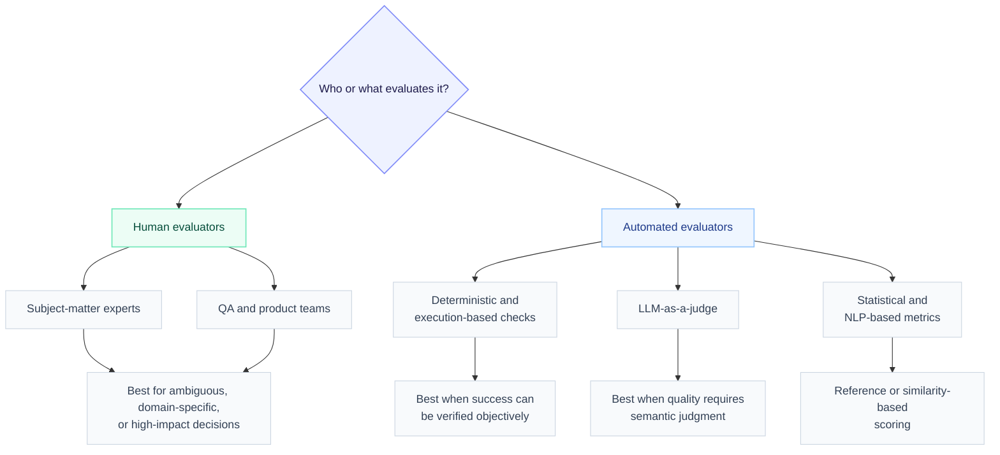
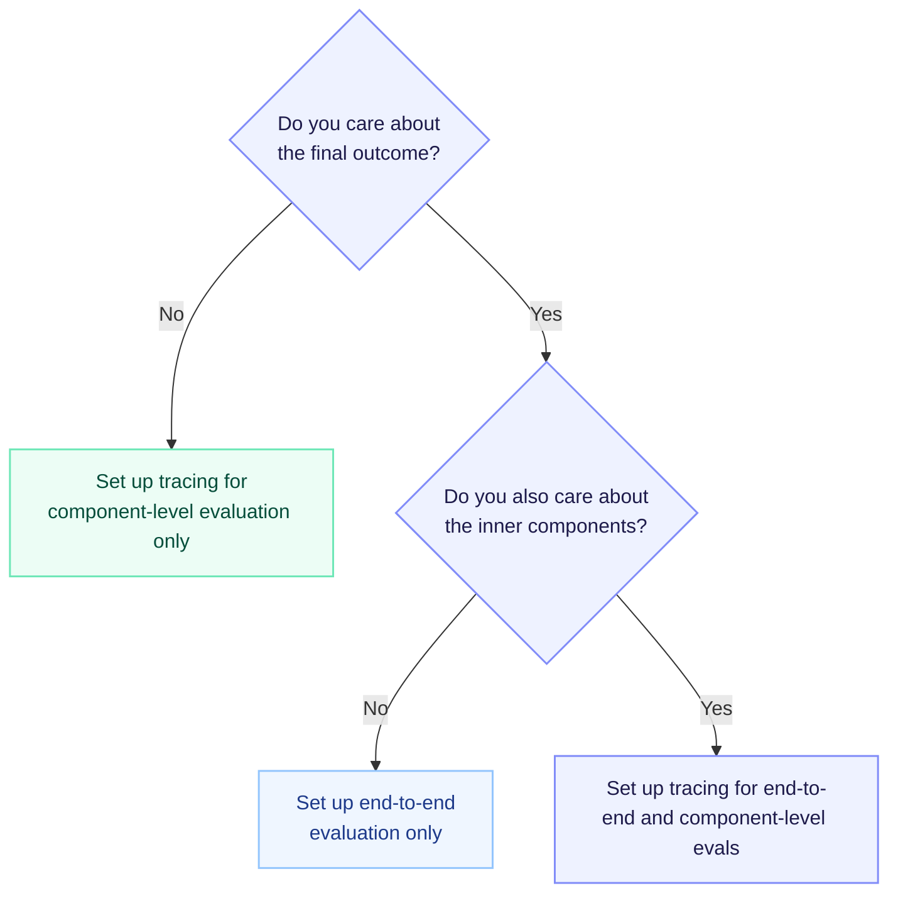

One of the biggest mistakes you can make when evaluating large language model (LLM) applications in 2026 is applying the same playbook to every AI system - regardless of its architecture, stage of development, or intended use case.

We've all seen some version of this advice:

- Prepare an evaluation dataset.
- Choose the metrics you want to evaluate.
- Run experiments and pre-deployment regression tests.
- Done.

But anyone who has actually built an LLM evaluation pipeline knows these four innocent-looking steps conceal hundreds of decisions, and just as many ways to get them wrong.

A RAG pipeline should not be evaluated like a customer support agent. A coding agent should not be evaluated like a medical summarization system. And a prototype being tested by three engineers should not inherit the same workflow as a production application serving millions of users.

In this guide, having built one of the world's most widely used open-source LLM evaluation frameworks, we'll examine how evaluation should change across the most common LLM use cases, architectures, and stages of the development lifecycle. We'll also tackle the questions that tend to emerge once evaluation moves beyond a single project:

- How do you choose the right evaluation workflow for each use case?
- When should you use component-level, end-to-end, human, or model-based evaluation?
- How do offline testing and production evaluation fit together?
- How do you standardize evaluation across teams without forcing every AI system into the same mold?

The devil, as always, is in the details.

Let's get started.

## What is LLM evaluation?

LLM evaluation is the process of systematically measuring the quality, reliability, safety, and task performance of an LLM-powered system against a defined set of test cases and acceptance criteria.

In practice, this usually involves a combination of LLM-as-a-judge metrics, deterministic checks, task-specific scoring functions, and - where additional judgment or ground truth is required - human annotation.

[image]

Despite the name, "LLM evaluation" rarely means evaluating a language model in isolation. More often, it means evaluating the complete system built around that model, including its prompts, retrieval layer, tools, memory, orchestration logic, guardrails, and user interface.

The most common types of LLM applications include:

- **AI agents**: Goal-directed systems in which an LLM dynamically plans, reasons, selects tools, maintains state or memory, and executes multi-step trajectories in response to environmental feedback.
- **Chatbots**: Multi-turn conversational systems that generate responses from dialogue history, system instructions, user context, retrieved knowledge, and potentially tool outputs while maintaining coherence across turns.
- **Voice AI**: Real-time conversational systems combining automatic speech recognition, dialogue orchestration, LLM inference, and text-to-speech under constraints such as latency, turn detection, interruptions, and barge-in handling.
- **RAG pipelines**: Retrieval-augmented generation systems that transform a query, retrieve candidates from vector or hybrid indexes, rerank and assemble context, and generate an answer intended to remain grounded in the retrieved evidence.
- **MCP-based LLM apps**: Systems that use the [Model Context Protocol](https://modelcontextprotocol.io/docs/learn/architecture) to discover and interact with external tools, resources, and prompt templates through a standardized client-server interface.

These categories are not mutually exclusive. A voice assistant is often also a chatbot. An AI agent may use RAG to acquire context, invoke tools exposed by MCP servers, and communicate with users through either text or voice. In sufficiently complex systems, all five can exist within the same application.

### 1. Interaction type

This determines how the evaluation dataset and harness should represent the interaction.

- **Single-turn**: One initiating input produces one execution and outcome.
- **Multi-turn**: The system and user interact across multiple turns, with later behavior depending on earlier exchanges.

An agent can be single-turn even if it executes dozens of internal steps. The distinction concerns the interaction between the user and system, not the number of model calls, tool calls, or spans inside the execution.

### 2. Modality

This determines the types of inputs and outputs the application must process and which modality-specific qualities need to be evaluated.

- Text
- Audio or voice
- Images
- Video

Input and output modalities should be considered separately. A system might accept an image and return text, receive voice and generate voice, or process video while producing structured data.

### 3. Context and action access

This describes how the application acquires external information and interacts with systems beyond the model itself.

- **Model-only**: The application relies entirely on information available in the prompt and model weights.
- **RAG or retrieval**: The system retrieves external context from documents, databases, search indexes, or memory.
- **Function and tool calling**: The model invokes predefined functions or APIs to retrieve information or perform actions.
- **MCP**: The system accesses tools, resources, and prompts through a standardized client-server protocol.
- **Browser or computer use**: The agent interacts with software through rendered interfaces rather than predefined APIs.
- **Hybrid access**: The application combines retrieval, tools, MCP servers, browser use, and other external capabilities.

RAG primarily gives the system additional context. Function calling and MCP can provide both context and the ability to act. This distinction becomes important because evaluating whether an agent found the correct information is different from verifying whether it successfully changed the external environment.

| Example application           | Interaction type          | Input modality | Output modality | Context and action access                                                        |
| ----------------------------- | ------------------------- | -------------- | --------------- | -------------------------------------------------------------------------------- |
| Coding assistant              | Multi-turn                | Text           | Text and code   | Hybrid: repository access, tool calling, and browser or computer use             |
| Customer experience agent     | Multi-turn                | Text           | Text            | Hybrid: RAG, customer data, and tools for actions such as refunds or escalations |
| RAG question-answering system | Single-turn               | Text           | Text            | RAG or retrieval                                                                 |
| Voice AI assistant            | Multi-turn                | Audio or voice | Audio or voice  | Hybrid: retrieval and function or tool calling                                   |
| MCP-based application         | Single-turn or multi-turn | Text           | Text            | MCP resources, prompts, and tools                                                |

With these definitions in place, you should now be able to decide which bucket your LLM app falls into. Still, however, it does not tell us how that system should be evaluated.

To answer the question of how your now classified LLM app should be evaluated, you have to make two separate decisions:

1. **Who, or what, will perform LLM evaluation?**
2. **How much of the system's behavior will that evaluation cover?**

These decisions are independent. A human can evaluate an agent's overall task completion or inspect one tool call. An automated evaluator can do the same. The evaluator determines how the judgment is made; the scope determines what the judgment is about.

That's what the next two sections go over.

## LLM evaluation differs across evaluators

At the highest level, evaluation is performed through either human annotation or automated evals.

The trade-off is straightforward: human annotation can provide richer, domain-specific judgment, but it is slower, more expensive, and constrained by annotator availability. Automated evals are repeatable and available on demand, making them practical for workflows such as CI/CD, where you cannot guarantee that a qualified reviewer will be available every time a test run starts.

### Human evaluators

Human annotation asks annotators to score, classify, rank, or critique an LLM application's behavior. In enterprises, annotators are typically QA teams, product managers, or subject-matter experts (SMEs)—an umbrella term for anyone with enough domain knowledge to distinguish a correct result from a merely plausible one.

That expertise differs by industry:

- **Healthcare**: Clinicians verify clinical accuracy, patient safety, and appropriate escalation.
- **Legal**: Lawyers validate legal reasoning, citations, and jurisdiction-specific advice.
- **Logistics**: Operations teams assess routing decisions, delivery exceptions, and constraint handling.
- **Insurance**: Adjusters and underwriters evaluate coverage decisions, claims handling, and regulatory compliance.

The annotation itself is often easier than getting humans to perform it consistently. Teams must assign test cases or traces to the right annotators, prioritize important failures, track completion, resolve disagreements, and return the findings to engineering.

In practice, this often means triaging traces in Jira, notifying annotators through Slack, and manually tracking who owns each decision.

**Industry standards that have emerged recently involve concepts such as annotation queues** that make this workflow manageable by allowing teams to filter, prioritize, assign, and track cases in one place. We will cover how to design these annotation workflows—including assignment, sampling, calibration, and adjudication—in a later best practices section.

Human annotation is most valuable when defining a new benchmark, investigating unfamiliar failures, or judging qualities that cannot yet be expressed reliably in code.

But it remains expensive and inconsistent at scale, so mature teams generally use humans to establish ground truth, calibrate automated evaluations, and handle ambiguous cases—not to inspect every experiment or production interaction.

### Auto-evaluators

Automated evaluators replace the human reviewer with a repeatable scoring procedure. Importantly, **LLM-as-a-judge is only one category of automated evaluation**, not a synonym for the entire field.

Automated evaluations include:

- **Deterministic and execution-based checks**: Exact matching, regular expressions, schema validation, tool-argument validation, code execution, unit tests, database assertions, environment-state checks, and other rules that return an objectively verifiable result.
- **LLM-as-a-judge metrics**: Large language models that apply criteria, evaluation steps, or rubrics to judge semantic qualities such as correctness, relevancy, groundedness, completeness, safety, or task completion; some might even use an algorithm such as G-Eval.
- **Statistical and NLP-based metrics**: BLEU, ROUGE, BERTScore, embedding similarity, token-level comparisons, and other reference-based or model-based scoring methods, although I personally argued that those shouldn't be used for LLM evaluation here.

These methods should not be treated as a hierarchy in which the most sophisticated model is automatically the best evaluator:

- If an agent is expected to create a database record, directly checking the tools that were called by an LLM is stronger evidence than using LLM-as-a-judge to determine whether the record was created.
- If an MCP-based coding agent is expected to fix a bug, running an exact-match test is more meaningful than judging the final explanation.
- If success depends on tone, coherence, or whether an answer addresses an ambiguous request, a deterministic assertion may be impossible and an LLM judge may be appropriate.

So far, we have discussed **how LLM applications can be evaluated**, but not **which parts of their behavior should be judged**. That requires a second decision: the scope of evaluation.

## LLM evaluation differs by evaluation scope

Human- or automated-evaluator-driven LLM evaluation can assess the application end to end - whether it achieved the intended outcome - and/or isolate one or more components within its execution.

It is important to decide this scope early because it determines what you need to set up. End-to-end evaluation requires evidence of the final outcome, while component-level evaluation requires tracing so you can inspect the intermediate steps that produced it. If both matter, you need both forms of evaluation.

### End-to-end evaluation (black-box)

End-to-end LLM evaluation is where most people begin because it is the most intuitive form of evaluation. It asks whether an application achieved its intended outcome while treating its internal execution as a black box - essentially, we don't care what happened during your LLM app's execution, but only what the final observable result is.

It's sort of like the opposite of micromanaging.

What constitutes an outcome depends primarily on the interaction type:

- **Single-turn**: Did one execution complete the requested task?
- **Multi-turn**: Did the application achieve the expected outcome across the entire conversation?

It also depends heavily on the modality:

- **Text**: Was the response or completed task correct, relevant, and compliant?
- **Voice**: Was the task completed with acceptable latency, intelligibility, turn-taking, and interruption handling?
- **Image**: Did the system interpret or generate the visual information correctly?
- **Video**: Did it understand or produce the correct events across time?

[Image: A scenario entering an LLM application represented as a black box, with RAG, tools, MCP, and model calls faded inside it. The evaluation compares only the initial task with the final response or environment state.]

End-to-end evaluation changes much less according to external access because those mechanisms sit inside the black box:

- A coding agent passes if its patch fixes the bug, whether it used RAG, MCP, or native tools.
- A support agent passes if it resolves the issue, whether it queried the CRM through function calling or an MCP server.
- A research application passes if its conclusions are correct and supported, regardless of how its retrieval pipeline is implemented.

The exception is when a particular internal behavior is itself part of the requirement - for example, using an approved data source, avoiding a prohibited tool, or remaining below a cost limit.

End-to-end evaluation is useful because it:

- Aligns closely with the outcome users and businesses care about.
- Remains valid when the underlying architecture changes.
- Captures failures that only emerge when several components interact.
- Prevents strong component scores from disguising an unsuccessful application.

Its limitations are equally important. End-to-end evaluation can tell you that the application failed, but rarely why. It may also overlook inefficient, expensive, or unnecessarily long trajectories, or mark a policy-violating execution as successful simply because compliance was not included in the expected outcome. And even when it catches a failure, it provides little guidance on which component should be improved.

End-to-end evaluation verifies the destination. Component-level evaluation explains the path. This is why folks often start with end-to-end evals, then "upgrade" to component-level evals once they are more comfortable with their LLM evaluation process.

### Component-level evaluation (white-box)

If end-to-end evaluation is black box testing, component-level LLM evaluation is closer to white box testing. It examines the intermediate decisions, data, and actions that produced the outcome.

Unlike end-to-end evaluation, component-level evaluation changes significantly according to the application's external access:

- **RAG**: Evaluate query transformation, retrieval, reranking, context quality, grounding, and document permissions.
- **Function calling**: Evaluate tool selection, arguments, execution order, error handling, and interpretation of results.
- **MCP**: Evaluate server and resource selection, schema compliance, capability boundaries, and the handling of untrusted content.
- **Browser or computer use**: Evaluate navigation, action sequencing, confirmation requirements, and external state changes.

[Image: An opened LLM application showing checkpoints across planning, retrieval, tool selection, MCP access, execution, and final state, with security boundaries highlighted around external systems.]

This is also where security becomes a much larger part of LLM evaluation. Once an agent can use tools or MCP servers, it can do more than generate a bad response: it can access unauthorized data, leak sensitive context, follow prompt injections hidden inside tool results, escalate permissions, or perform consequential actions without approval.

These failures may not appear in the final output. An agent can complete its task while reading data it did not need, sending information to an untrusted server, or briefly placing an external system into an unsafe state. A successful outcome does not necessarily imply a safe execution.

Component-level evals:

- Make failures easier to locate.
- Expose security, cost, and policy violations hidden behind the final result.
- Must account for the fact that agents can reach the same valid outcome through different trajectories.
- Should test important decisions and constraints without requiring one predetermined path.

End-to-end evaluation verifies that the application reached the right destination. Component-level evaluation verifies that it got there correctly, efficiently, and safely.

One last bit of LLM evaluation theory before diving into real-life LLM evaluation examples. Introducing the three units of LLM evaluation: **goldens, test cases, and traces.**

## The 3 universal units of LLM evaluation

If you ask someone how long it takes Usain Bolt to run 100 meters, they'll tell you 9.58 seconds; how tall Mount Everest is, 8,849 meters; what temperature water boils at, 100°C; and how many lines of code it takes to make a good AI agent, they'll report you to HR.

Here's the point: measurement is only meaningful when the unit matches the thing you are trying to understand - and LLM evaluation is no different.

When we agree on a universal unit of evaluation, two things become abundantly clear: what counts as one thing being measured and what evidence represents success.

LLM evaluation frequently gets this backward. Teams select Task Completion, Faithfulness, G-Eval, or another metric before agreeing on what one row in their evaluation dataset represents just because that's what gets mentioned in generic online tutorials.

There are three units of LLM evaluation, with variations for both single and multi-turn LLM apps:

| Unit      | Evaluation lifecycle | Single-turn representation                                                   | Multi-turn representation                                              | Primary role                                   |
| --------- | -------------------- | ---------------------------------------------------------------------------- | ---------------------------------------------------------------------- | ---------------------------------------------- |
| Golden    | Before execution     | Input, expected output, context, and constraints                             | Scenario, user description, expected outcome, context, and constraints | Defines what should happen.                    |
| Test case | After execution      | The golden plus actual output and structured runtime evidence                | The golden plus conversation turns and structured runtime evidence     | Structures the evidence used for measurement.  |
| Trace     | After execution      | Model calls, retrieval, tools, timings, errors, and other spans from one run | The same execution evidence across every turn of a conversation        | Preserves how the execution actually happened. |

Together, these units separate evaluation intent from measurable results and the full execution behind them:

- **Goldens** specify the input, expectations, and constraints before the application runs.
- **Test cases** combine that specification with selected runtime evidence in a consistent structure that metrics can evaluate.
- **Traces** retain the more complete, free-form execution path for evaluation, debugging, and failure discovery.

Let's talk about how they differ.

### Goldens exist before execution

The first unit of LLM evaluation we'll encounter is the golden, which in this guide refers to a curated record in an evaluation dataset.

A golden is the pre-inference specification of one evaluation. It exists before the application generates a response, calls a tool, retrieves a document, or changes an external environment.

A golden may contain different fields:

| Purpose                       | Single-turn field | Multi-turn field | Type            | Description                                                       |
| ----------------------------- | ----------------- | ---------------- | --------------- | ----------------------------------------------------------------- |
| Initiate the evaluation       | Input             | Scenario         | Text            | The query or circumstances used to invoke the application.        |
| Define success                | Expected output   | Expected outcome | Text            | The ideal response or outcome the application should produce.     |
| Describe the simulated user   | —                 | User description | Text            | The characteristics of the user interacting with the application. |
| Supply supporting information | Context           | Context          | List of text    | Static context relevant to the evaluation.                        |
| Specify intended tool use     | Expected tools    | —                | List of tools   | The tools the application is expected to call.                    |
| Organize and filter records   | Metadata          | Metadata         | Key-value pairs | Custom metadata associated with the golden.                       |
| Preserve notes                | Comments          | Comments         | Text            | Notes or comments about the golden.                               |

Not every golden needs every field. What matters is that it contains enough information to initiate the behavior and later determine whether that behavior was successful.

[Image: Evaluation timeline divided into two sides. Before execution: a golden containing the task, initial state, expected outcome, and constraints. After execution: a structured test case and a free-form trace containing what actually happened.]

The concrete structure depends on the application.

- **AI agent**: A task, initial environment state, available capabilities, expected outcome, and any constraints the agent must follow.
- **RAG application**: A user question, expected answer or reference information, and optionally the corpus or sources from which the answer should be derived.
- **Multi-turn chatbot**: A scenario, user description, conversation goal, expected outcome, and instructions for simulating subsequent turns.
- **Multimodal application**: Text, audio, images, or video inputs together with modality-specific expectations such as latency, transcription, visual grounding, or temporal understanding.

For an agent, the input may not resemble a traditional prompt at all. It could be:

> Resolve the customer's duplicate charge without issuing more than one refund.

Increasingly, with AI agents, we're also seeing goldens containing data on mocked tool calls with hardcoded expected input parameters and a list of tools to call.

[Image: Four example golden cards for an AI agent, RAG application, multi-turn chatbot, and multimodal application. Keep the field names conceptually consistent while showing different payloads.]

This distinction is essential for standardization. An input does not need to contain the same kind of data across every application, but it should retain the same definition:

> The information supplied to the application to initiate the behavior being evaluated.

For a coding agent, that might be an issue description and repository state. For a RAG application, it might be a question. For a conversational agent, it might be a scenario and simulated user profile.

The payload changes; the conceptual role does not.

The same principle applies to other shared terms:

- **Context** describes information available before or during execution.
- **Expected output/outcome** describes the state or behavior that represents success.
- **Constraints** describe what the application must or must not do while pursuing that outcome.
- **Metadata** describes the golden rather than the behavior being tested.

This shared vocabulary allows teams to standardize dataset versioning, ownership, release gates, and reporting without forcing every LLM application into an identical schema.

A golden is therefore universal in shape & role, not in the specific data.

Consider two single-turn LLM apps: A document summarizer and a RAG QA. They couldn't be more different - one's inputs are documents while the other's are questions. Yet - the golden as a unit allows teams to run the same evaluation metrics on them regardless of what the data within the input is.

### Test cases exist after execution

Once an application runs against a golden, the result can be represented as a **test case.**

A test case combines the pre-execution specification with structured runtime evidence. It may attach:

- The actual output
- Retrieved context
- Actual tool calls
- Conversation turns
- Evaluation scores and reasons

Goldens and test cases are structurally similar because the test case inherits the golden's input, expectations, constraints, and metadata. The difference is temporal:

One golden maps to many test cases across different test runs. The same coding task can be executed against several model versions, prompts, tool configurations, or agent architectures. Each run begins with the same golden but produces a different test case.

[Image: Two columns of single turn vs multi-turn test case, mapped from goldens]

This structure makes test cases useful for LLM evaluation metrics to act on. For example, the tool correctness metric can compare expected and actual tool calls. A retrieval metric can access the retrieved and reference context. The metric changes, but the underlying test case remains structured.

### Traces also exist after execution

Sometimes, a test case isn't structurally expressive enough for LLM evaluation. That's where traces come in. A trace is another post-execution representation, but it serves a different purpose.

Instead of reducing the run to predefined fields in a test case, a trace preserves the execution more freely: model calls, prompts, retrieval steps, tool invocations, nested agents, intermediate outputs, errors, retries, timings, and state transitions.

Traces may have a technical structure - usually a hierarchy of spans - but their semantics are comparatively unstructured. Different agents may use different span names, nesting conventions, tools, and execution paths. Even two runs of the same agent can produce traces of radically different shapes.

[Image: A large branching agent trace containing planning, retrieval, model, tool, retry, and sub-agent spans. Arrows extract a small number of stable fields into a structured test case.]

A trace can therefore be treated as a free-form superset of runtime evidence. It may contain much more information about what happened than a test case, but it does not necessarily contain what should have happened.

That distinction matters:

- A trace is highly expressive but difficult to compare consistently.
- A test case is less expressive but deliberately structured for measurement.
- A golden supplies the expectations that neither runtime representation can invent for itself.

This means the metrics also change - trace evaluation focuses more on metrics that excel on unstructured data such as Task Completion, Step Efficiency, and the Plan Adherence metric.

Humans and automated evaluators can inspect either test cases or traces. The question is not whether traces can be evaluated - they can - but whether their variable structure provides a stable quantitative signal.

### From test cases to traces - and back again

This is a detour, so those who are not interested can skip ahead, but I'm going to get into a bit of history on traces and test cases.

Before AI agents became the center of LLM evaluation, RAG established many of the field's original conventions. Its evaluation structure was relatively predictable:

> Question → retrieved context → generated answer

The corresponding test case was also predictable. It could contain an input, actual output, expected output, retrieval context, and reference context. Metrics such as contextual precision, recall, and answer relevancy knew exactly where to find the evidence they required.

Agents broke that comfortable structure.

An agent might retrieve information, formulate a plan, call several tools, delegate work, recover from an error, and modify an external environment before producing a final response. More importantly, teams initially did not know which intermediate decisions would matter or where failures would occur.

A predefined test-case schema could only capture anticipated behavior. Traces allowed teams to capture everything and decide what mattered afterward.

The industry therefore moved from **test-case-first evaluation** toward **trace-first evaluation**.

[Image: Three-stage evolution - structured RAG test cases, followed by free-form agent traces, followed by structured agent test cases extracted from trace evidence. Label the stages "Known signals," "Discovering failures," and "Structuring recurring failures."]

This shift made agent evaluation more expressive, but it introduced a new problem: Raw traces are excellent debugging artifacts but inconsistent measurement interfaces.

One agent may solve a task with three tool calls; another may use eight. One team may represent retrieval as a single span; another may record query transformation, search, reranking, and context construction separately. A metric applied directly to both traces can end up measuring instrumentation choices instead of application quality.

Over time, however, the most important agent failures have become more predictable:

- Selecting the wrong tool
- Supplying invalid arguments
- Ignoring a failed tool response
- Claiming success without changing the environment

Once a failure becomes predictable, it no longer needs to remain free-form. It can be extracted into a structured test case.

Expected tools can become typed fields. Required actions can become assertions. Final environment state can be validated deterministically. Policy violations can become explicit constraints. Trace evidence can still explain the execution, but the signals used for benchmarking become stable and comparable.

This is why agent evaluation is now slowly migrating from:

> Test cases → traces → better test cases constructed from traces

The trace is not disappearing. Its role is becoming clearer.

- **Goldens define what should happen.**
- **Traces preserve everything that did happen.**
- **Test cases structure the evidence needed to measure the difference.**

In development, the workflow generally begins with a golden, runs the application, and produces both a test case and a trace. In production, the workflow may begin with a trace, surface an unexpected failure, and convert that failure into a new golden for future regression testing.

```mermaid
flowchart LR
    golden["Golden"]
    execution["Application execution"]
    evidence["Test case and trace"]
    regression["Regression testing"]
    deployment["Deployment"]
    production["Production traces"]
    discovery["Failure discovery"]

    golden --> execution
    execution --> evidence
    evidence --> regression
    regression --> deployment
    deployment --> production
    production --> discovery
    discovery -- "New or updated golden" --> golden

    classDef goldenNode fill:#EEF2FF,stroke:#818CF8,color:#1E1B4B,stroke-width:1.5px
    classDef development fill:#EFF6FF,stroke:#93C5FD,color:#1E3A8A,stroke-width:1.5px
    classDef productionNode fill:#ECFDF5,stroke:#6EE7B7,color:#064E3B,stroke-width:1.5px
    classDef discoveryNode fill:#FFF7ED,stroke:#FDBA74,color:#7C2D12,stroke-width:1.5px

    class golden goldenNode
    class execution,evidence,regression development
    class deployment,production productionNode
    class discovery discoveryNode
```

That feedback loop is the foundation of a mature evaluation system: traces discover what teams did not know to test, goldens preserve what they learn, and test cases turn that knowledge into repeatable measurement.

## Your LLM application determines its evaluation metrics

We can now return to the advice at the beginning of this guide: "Choose the metrics you want to evaluate."

That instruction comes too early. A metric should be the consequence of the decisions we have covered so far, not an item selected independently from a catalog.

The application's structure first determines what can go wrong and what evidence will exist:

- **Interaction type** determines the unit of success. A single-turn extractor can be judged from one output, while a multi-turn chatbot may need Conversation Completeness, Turn Relevancy, or overall Task Completion across the full exchange.
- **Modality** introduces qualities that text-only metrics cannot see. A voice agent needs transcription accuracy, turn-taking, and interruption handling in addition to the quality of its words.
- **External access** determines which intermediate behaviors matter. A RAG pipeline creates retrieval evidence for contextual precision and recall. A tool-using agent creates tool selections, arguments, results, and external state changes that can be validated.

The evaluation scope then determines where those metrics should be applied. **End-to-end metrics** ask whether the application achieved the outcome that users and the business care about. **Component-level metrics** inspect the retrieval, generation, planning, or tool use that produced it.

Operational measurements such as latency, cost, and error rate are not irrelevant - they often determine whether an application is viable in production. However, they measure system performance rather than the quality of an LLM's behavior, so they should be tracked alongside LLM evaluation metrics instead of being treated as the focus of this guide.

This also explains why a metric and an evaluator are not the same thing. Task Completion describes the quality being measured, but the evidence and evaluator depend on the application:

- For a document extractor, success may be determined through an exact comparison with a reference record.
- For a coding agent, executable tests and the final repository state provide stronger evidence than its explanation of what it changed.
- For an ambiguous support conversation, an LLM judge or human annotator may need to interpret whether the customer's problem was actually resolved.

Finally, the metric must match the unit it acts on. A **golden** supplies the expected outcome or constraints. A **test case** places those expectations beside stable runtime fields so a metric can compare what should have happened with what did happen. A **trace** supplies richer execution evidence when the relevant behavior cannot be reduced to those fields.

A Faithfulness metric, for example, is only meaningful if the generated answer and retrieval context are available. Tool Correctness requires actual tool calls and, where appropriate, expected tools or constraints. Task Completion for an agent may need the initial task, the full trace, and evidence of the final environment state. Choosing the metric without checking whether its required evidence exists produces a score, but not necessarily a valid measurement.

Metric selection should therefore follow this order:

1. Define the outcome that represents success.
2. Identify component failures or behavioral constraints that could make that outcome unacceptable.
3. Determine whether the required evidence belongs in a golden, structured test case, or trace.
4. Choose the human or automated evaluator best suited to that evidence.
5. Define the score, threshold, or assertion that separates passing from failing.

This is why the examples in the next section will not share one standard bundle of metrics. The logistics extractor, coding agent, RAG pipeline, and voice chatbot each produce different evidence and have fundamentally different definitions of success. If you want a catalog of individual metrics after applying this framework, [this complete guide to LLM evaluation metrics](https://www.confident-ai.com/blog/llm-evaluation-metrics-everything-you-need-for-llm-evaluation) covers them in detail.

## There are 7 questions to ask before any LLM evaluation attempt

If you're still with me, you should pat yourself on the back, because this is a very long article (and if you're reading this in one sitting, you'll want a hydration break).

More importantly, you have now covered enough of the foundation to make LLM evaluation feel less abstract.

Putting everything together, here are the seven questions you need to be able to answer before going into the real-life examples:

1. **What is the interaction type?** Is each evaluation a single request or a multi-turn interaction that evolves over time?
2. **What modalities are involved?** Does the application consume or produce text, voice, images, video, or some multimodal combination?
3. **What external access does it have?** Is it model-only, or does it use RAG, function calling, MCP, browser use, memory, or other external systems?
4. **What defines success?** Which outcomes and component behaviors should the metrics measure?
5. **Who will evaluate it?** Will quality be determined through human annotation, automated evaluation, or a combination of both?
6. **What scope will be evaluated?** Are you measuring the end-to-end outcome, individual components, or both?
7. **Where will evaluation happen?** Are you testing during development, monitoring in production, or both?

These questions are not asking you to design the entire evaluation system immediately. Their purpose is to produce a clear evaluation brief.

For example, imagine being able to communicate this:

> We are evaluating a single-turn coding agent that works with text and code, accesses repositories through tools and MCP, uses executable tests alongside sampled human annotation, measures both task completion and tool-use quality, and runs evaluations during development and on sampled production executions.

That one description already narrows the workflow considerably. It tells you that conversational metrics are probably unnecessary, deterministic metrics targeting tool use should carry more weight than subjective judgments, tool and security behavior must be captured, and production evaluation cannot depend on humans inspecting every execution.

You also do not need to choose or commit to only one answer. Most real evaluation programs combine:

- Human annotation with automated evaluation
- End-to-end outcomes with component-level checks
- Curated development benchmarks with sampled production behavior

The goal is not to use every method. It is to make each choice deliberately.

Once you can answer these seven questions, you can combine them with goldens, test cases, and traces to design an evaluation around the application instead of forcing the application into a generic evaluation template.

## LLM evaluation on real-world examples

Back when I was in school, math exams always got the better of me. I’d walk into a test confident that I had prepared everything in the syllabus, but the moment the teacher rearranged the same ideas into a slightly different problem, it suddenly felt completely new.

LLM evaluation can feel exactly like that—everything makes sense until a real application combines agents, tools, retrieval, and modalities in a way none of the examples prepared you for.

We have spent enough time on the theory. It is time to apply it.

This section will focus exclusively on **pre-deployment development LLM evaluation** because, as we’ll see later, production LLM evaluation isn’t nearly as interesting—or as difficult to crack—once the development workflow is sound.

We’ll work through four real-world systems:

- **A logistics document extractor**: A multimodal system extracts shipment details from bills of lading, commercial invoices, packing lists, and customs forms into a validated structured schema.
- **A coding assistant with GitHub MCP access**: An agent receives a GitHub issue, inspects the repository, edits code, runs tests, and uses GitHub’s MCP server to update the issue or open a pull request.
- **An enterprise RAG QA pipeline**: An employee submits a question, the system retrieves relevant internal documents, and it generates a grounded answer.
- **A voice AI chatbot for a hospital call center**: A multi-turn voice agent answers operational questions, collects caller information, routes requests, schedules appointments, and escalates to hospital staff when necessary.

These examples will not cover every possible architecture, but they should cover enough building blocks to evaluate most systems by composition.

And if your architecture combines these components in an even stranger way - or you simply want to see it evaluated in practice - you know where to [book a demo with the Confident AI team](https://www.confident-ai.com/book-a-demo) :)

Once a development workflow is set up correctly, production evaluation becomes conceptually straightforward: capture live executions, sample the relevant traces, apply the same evaluators, and route important failures back into the development dataset.

Finally, for each system, we will determine:

- What the fields within a golden represent
- How to structure its test cases and traces
- Which outcomes and components should be evaluated
- Which evaluation methods appear reasonable but produce misleading results

The four examples will focus on automated LLM evaluation metrics and deterministic checks rather than repeatedly prescribing human annotation. This is a choice about the scope of the examples, not a recommendation to remove humans from evaluation. Human annotations can be applied to almost any test case or trace regardless of the application's interaction type, modality, or external access, so repeating that option in every example would tell us little about how their evaluation designs differ.

In practice, humans should still help define quality, establish ground truth, calibrate automated metrics, and judge ambiguous or high-impact cases. Using them appropriately is an LLM evaluation best practice; see [Never leave humans out](#3-never-leave-humans-out) below.

### Evaluating a logistics document extractor

Let’s begin with the system that looks simplest on the surface.

A logistics document extractor receives a bill of lading, commercial invoice, packing list, or customs form and converts it into a structured record. There is no conversation to simulate or agent deciding which tool to call, but document quality, layouts, tables, OCR, and field normalization give us more than enough ways to get the evaluation wrong.

Using our framework above, here’s how I would classify this use case:

- **Interaction type**: Single-turn.
- **Modalities**: Images. Although it might look like PDF is its own modality—most LLM APIs like Anthropic let you hand one over the same way you hand over a JPEG—that’s a convenience at the surface. Underneath, the file is decomposed: pages are rasterized, the text layer is extracted where present, and both are fed in as pixels and tokens.
- **External access**: Usually nothing—no RAG or tool calling. Deterministic pipelines that preprocess or route documents into the extractor do not count as external access here.
- **Definition of success and metrics**: The extracted record matches the verified reference record, satisfies the required schema, and contains no missing or fabricated fields. Use exact match for strictly normalized outputs, field-level accuracy for partial errors, and schema validation for structural correctness.
- **Evaluator**: Deterministic automated checks.
- **Evaluation scope**: End-to-end, only the final extracted record counts. (Note: Scope is determined by you; we’ve decided not to care about components in this example, but it’s ultimately your call)

One golden should represent one complete document-processing job, not one extracted field and not necessarily one page.

So the question is, what should the input of the golden be? Should it be the entire PDF? After all, that’s what we are passing into our LLM document extractor.

The answer is no - we do not need the input to be strictly the raw document itself. What we are really looking for is a reliable starting point to benchmark against in our dataset. For this example, although including the raw PDF makes perfect sense, using a stable link to the PDF works better because it is easier to read, store, and work with throughout the evaluation process.

| Golden field (single-turn) | What it represents                                       | Example                                                               |
| -------------------------- | -------------------------------------------------------- | --------------------------------------------------------------------- |
| Input                      | A stable link to one complete logistics document         | `s3://eval-datasets/bill-of-lading-042.pdf`                           |
| Expected output            | The correctly extracted and normalized structured record | `{"bill_number":"BOL-042","carrier":"Maersk","total_weight_kg":1240}` |

Realistically, the input and expected output are all you need. The final step is simple - run your document extractor against your dataset of goldens, generate the actual output and construct the corresponding list of test cases.

Once you have your test cases, you can now compare all the actual outputs with the expected outputs, mapped from the goldens, using a simple exact match metric - which is 100% deterministic and free of charge.

This resulting "benchmark" is what we call a test run.

Note that we skipped over the "how" in "run your document extractor against your dataset of goldens" - in practice, this usually involves either:

- Invoking your LLM app in code, running the evals locally through [DeepEval](https://deepeval.com/), or
- Invoking your LLM app through API calls, which can happen in code or on an [LLM evaluation platform](https://www.confident-ai.com/products/llm-evaluation) like Confident AI

Multiple test runs produce controlled experiments, and comparing two test runs side-by-side allows for regression testing. We'll talk about these two workflows in more detail later.

### Evaluating a coding assistant with GitHub MCP access

Now things become more agentic.

This coding assistant receives a GitHub issue, inspects a repository, edits code, runs tests, and uses GitHub’s MCP server to update the issue or open a pull request. Think Cursor, Codex, and Claude Code.

This is a significantly more complicated use case than our previous logistics document extractor:

- **Interaction type**: Multi-turn.
- **Modalities**: Text.
- **External access**: Repository and file-system access, and GitHub MCP capabilities that can read or modify external state.
- **Definition of success and metrics**: The patch resolves the issue, passes executable tests, preserves unrelated behavior, and uses tools correctly. Combine Task Completion with deterministic tests, Tool Correctness, and final repository or GitHub state validation.
- **Evaluator**: LLM-as-a-judge metrics and deterministic automated checks.
- **Evaluation scope**: End-to-end and component-level.

One golden should represent one coding task executed against one known repository state.

| Golden field (multi-turn) | What it represents                                                    | Example                                                                       |
| ------------------------- | --------------------------------------------------------------------- | ----------------------------------------------------------------------------- |
| Scenario                  | The GitHub issue to resolve and the repository state to start from    | Fix issue #184 against commit `a1b2c3d`: prevent duplicate webhook processing |
| Expected outcome          | The required code changes, passing tests, and resulting GitHub action | The affected function behaves as specified and all unit tests pass            |

To run LLM evaluation on a multi-turn LLM app like claude-code, you’ll need to first find a way to get your hands on the conversation in the first place.

To run LLM evaluation on a multi-turn LLM app like claude-code, you'll need to first find a way to get your hands on the conversation in the first place.

Here are two common mistakes I see people making when running multi-turn evals:

- They decide it is too difficult to do multi-turn evals because it's unclear how they would have conversations available for pre-deployment testing, and resort to single-turn, input-output based evals
- They decide it is better to run multi-turn evals in production instead because there are no existing conversations, and manual prompting isn't feasible from a time-commitment perspective

Both, as you may notice, are caused by a lack of existing user-assistant conversations in a pre-deployment setting. This is exactly why the structure of a multi-turn golden is so important.

Instead of benchmarking based on a fixed set of inputs, multi-turn evaluation relies on benchmarking against scenarios instead. This means that if we could somehow "simulate" user conversations from the scenario alone, we would solve all of our problems.

It turns out we can.

So here's the algorithm for running LLM evals on a coding assistant:

- Define a dataset of multi-turn goldens and select your set of multi-turn metrics
- For each scenario in your dataset of goldens, simulate the entire conversation
- Once completed, evaluate using your metrics

As a best practice, you should also connect your evaluation tool to the same MCP servers as your coding assistant before running the simulation. This gives the evaluator visibility into the available tools, allowing it to check tool selection and argument correctness at each simulated turn. [Confident AI supports this natively](https://www.confident-ai.com/docs/llm-evaluation/mcp-servers).

If you still remember high school chemistry, you'll know that in any chemical reaction, there's a slow step and a fast step. In multi-turn LLM evaluation, simulation is the slow step.

There are various ways you can run simulations:

- Locally, you can use [DeepEval's conversation simulator](https://deepeval.com/docs/conversation-simulator) to define how your user behavior can be simulated, including deterministic graphs to determine user behavior based on certain checkpoints in a conversation
- For enterprises that need [standardization and control on a centralized platform](https://www.confident-ai.com/products/ai-governance) with a UI layer, Confident AI will be the obvious choice

For those who want to dive deeper into multi-turn LLM evaluation specifically and what metrics are available, [here's a useful guide I've written](https://www.confident-ai.com/blog/multi-turn-llm-evaluation-in-2026) on this topic.

### Evaluating an enterprise RAG QA pipeline

The enterprise RAG QA example brings us back to a more familiar evaluation structure.

An employee submits a question, the system retrieves relevant internal documents, and an LLM generates an answer grounded in that context. There are no tools to choose, external actions to perform, or previous turns to remember.

One should not confuse a RAG QA system with a multi-turn use case (otherwise we would’ve called this a RAG chatbot):

- **Interaction type**: Single-turn.
- **Modalities**: Text.
- **External access**: Retrieval only to a knowledge base in the form of a vector database.
- **Definition of success and metrics**: The answer addresses the question correctly and is supported by the permitted internal documents. Use answer relevancy and correctness for the end-to-end response, Faithfulness for grounding, and contextual precision, recall, and relevancy for retrieval.
- **Evaluator**: LLM-as-a-judge metrics specific to RAG.
- **Evaluation scope**: End-to-end and component-level.

This example perhaps has the simplest golden structure of all the examples on this list: one golden should represent one question against one known version of the enterprise knowledge base.

| Golden field (single-turn) | What it represents                                           | Example                                                                                       |
| -------------------------- | ------------------------------------------------------------ | --------------------------------------------------------------------------------------------- |
| Input                      | One employee question                                        | How much annual leave do full-time employees receive?                                         |
| Expected output            | A correct answer grounded in the relevant internal documents | Full-time employees receive 20 days of paid annual leave per calendar year, per HR Policy 4.2 |

Similarly, the final step would be to evaluate your RAG QA by invoking your RAG pipeline using all the inputs within your dataset.

However, in contrast to the single-turn logistics document extractor example above, here we have explicitly noted that we need component-level evals as well as end-to-end evals.

In this case, we'll have to find a way to instrument our RAG QA to make sure we can capture the execution trace of our RAG pipeline, and place the corresponding RAG metrics on both the generator ([answer relevancy](https://deepeval.com/docs/metrics-answer-relevancy), [faithfulness](https://deepeval.com/docs/metrics-faithfulness)) and retriever (contextual [recall](https://deepeval.com/docs/metrics-contextual-recall)/[precision](https://deepeval.com/docs/metrics-contextual-precision)/[relevancy](https://deepeval.com/docs/metrics-contextual-relevancy)) respectively.

There are a ton of ways to capture execution traces, but I'd recommend using our open-source framework DeepEval to do so. It offers you the option to:

- Trace locally, and apply 50+ metrics on different components within agentic/RAG pipelines, with 20+ integrations in Python and TypeScript such as LangChain, LangGraph, CrewAI, Pydantic AI, and AI SDK
- Run regression tests and production monitoring on Confident AI when you start needing team collaboration capabilities

This isn't a guide to show how to use DeepEval, so for the rest of the setup I'll defer to [this guide I've written on RAG evaluation](https://www.confident-ai.com/blog/rag-evaluation-metrics-answer-relevancy-faithfulness-and-more) here, which includes the common RAG metrics that I've explicitly avoided diving too deep into.

### Evaluating a voice AI chatbot for a hospital call center

Finally, we have the application where modality plays the most important role.

If you haven’t read the coding agent example above, I highly recommend doing so, because this use case is an upgraded version of what we previously had.

A hospital call-center chatbot conducts multi-turn conversations, answers operational questions, collects caller information, schedules appointments, routes requests, and escalates to hospital staff when necessary.

You know the drill:

- **Interaction type**: Multi-turn.
- **Modalities**: Audio and text.
- **External access**: Conversational state, hospital knowledge retrieval, scheduling or routing APIs, and telephony controls.
- **Definition of success and metrics**: The caller's request is completed or correctly escalated while information remains accurate, required details are collected, and the conversation handles turns and interruptions correctly. Use Task Completion, conversation completeness, escalation correctness, tool-call and final-state validation, and interruption handling.
- **Evaluator**: LLM-as-a-judge metrics and deterministic automated checks.
- **Evaluation scope**: End-to-end.

One golden should represent one complete call scenario, not one caller utterance and not one predetermined transcript.

| Golden field (multi-turn) | What it represents                                                            | Example                                                                                                  |
| ------------------------- | ----------------------------------------------------------------------------- | -------------------------------------------------------------------------------------------------------- |
| Scenario                  | The caller's situation, request, and relevant context                         | A caller needs to reschedule a cardiology appointment due to a timing conflict                           |
| Expected outcome          | The correct resolution, such as answering, scheduling, routing, or escalating | The caller receives a confirmed cardiology appointment for July 21 at 2:30 PM and a confirmation message |
| Persona                   | Who is calling, how they speak, and the conditions of the call                | An elderly patient on speakerphone in a noisy waiting room who talks over long explanations              |

Notice the new row. In the coding assistant example, it didn't really matter who wrote the GitHub issue. On a phone call, the caller is half the test: an elderly patient on speakerphone, a frustrated caller who keeps cutting in, and someone calling from a busy emergency department waiting room will each break your agent in different ways - even when they want the exact same appointment.

This is why the persona should live separately from the scenario. Keep the task ("reschedule a cardiology appointment") in the scenario and the caller's traits ("hard of hearing, interrupts long explanations") in the persona, and you can run every scenario against every caller instead of writing a new golden for each combination.

The algorithm is the same as the coding assistant's - define your goldens, simulate each conversation, then evaluate. What changes is the simulation itself, which is now a live call:

1. An LLM role-plays the caller and writes their next line as text
2. A text-to-speech (TTS) model speaks that line, with background noise mixed in if the persona calls for it
3. The audio is streamed to your **deployed** voice agent over its real transport, such as WebRTC, a WebSocket, or a LiveKit room
4. The agent's spoken reply is recorded, along with how long it took to start speaking
5. A speech-to-text (STT) model transcribes the reply back into the conversation

The result is still a multi-turn test case, except every turn now carries the audio that was actually spoken and when it was spoken.

It's tempting to skip all of this and simulate a text conversation against the LLM behind your voice agent instead. Don't. That tests the one component that is least likely to be your problem. Most voice failures happen around the LLM: the agent's own STT hears "cardiology" as "radiology", turn detection cuts the caller off mid-sentence, the line goes silent for four seconds while a scheduling API responds, or the agent keeps talking after the caller says "wait, wait". None of these show up in a text simulation, and most of them don't show up in a transcript either.

So for voice, transcript-only evaluation is the method that looks reasonable but misleads. A transcript tells you whether the agent said the right thing. It cannot tell you whether the caller could hear it, whether the agent heard the caller correctly, or whether anyone could get a word in.

That's why I split voice metrics by what they look at:

| What you're evaluating | Metrics                                                                                                     | How they're scored                                                                 |
| ---------------------- | ----------------------------------------------------------------------------------------------------------- | ---------------------------------------------------------------------------------- |
| What was said          | Goal accuracy, conversation completeness, tool use, and a custom escalation correctness metric              | LLM-as-a-judge on the transcript                                                   |
| What the agent heard   | [Transcription accuracy](/docs/metrics-transcription-accuracy)                                              | Model-based, comparing what the caller said with what the agent's STT reported     |
| How it sounded         | Voice naturalness, speech intelligibility, voice consistency, audio integrity, and audio glitches           | Mostly deterministic, computed from the audio itself                               |
| When it happened       | [Turn-taking naturalness](/docs/metrics-turn-taking-naturalness), [agent responsiveness](/docs/metrics-agent-responsiveness) | Deterministic, computed from the call timeline                                     |

Escalation correctness deserves its own golden, because it's the highest-stakes behavior in this use case. If a caller mentions chest pain halfway through rescheduling, the right outcome is no longer a confirmed appointment - it's an immediate handoff to clinical staff. No built-in metric knows your hospital's escalation policy, so write it down as criteria for a custom conversational metric like [G-Eval](/docs/metrics-llm-evals).

And just like the coding assistant, don't rely on the conversation alone to tell you whether the task actually happened. After each simulated call, check the scheduling system directly: is the July 21 slot booked, and was the original appointment released? That's a deterministic final-state check, and it costs nothing to run.

If you need a single number to gate a release on, [voice reliability](/docs/metrics-voice-reliability) combines responsiveness and audio integrity into one score, and drops straight to zero on catastrophic failures like the agent never answering - a few clean turns can't average away a dead call.

There are also two traps specific to voice simulation:

- **The polite caller.** By default, a simulated caller waits for the agent to finish speaking before replying. Real callers don't. [Give the persona interruption behavior](/docs/conversation-simulator-voice-interruptions) and use a full-duplex connection so the caller can barge in mid-sentence - then let the turn-taking metrics tell you whether your agent stopped to listen or kept steamrolling.
- **The evaluator's own ears.** The STT model that transcribes your agent's replies is now part of your measurement. If it mishears your agent, your metrics will blame your agent. Use the most accurate STT model you can afford for evaluation, even if it isn't the one your agent uses in production.

Finally, remember how simulation was the slow step? In voice, it's even slower. Every call happens in real time, and calls run one at a time because each connection holds a single live session - a three-minute call takes three minutes to simulate. Be deliberate about which scenario and persona pairs you run on every change, rather than running the full cross product each time.

As for how to run all of this:

- Locally, DeepEval's conversation simulator has a [voice mode](/docs/conversation-simulator-voice-mode) that connects to agents built on ElevenLabs, LiveKit, Vapi, Pipecat, or a raw-audio WebSocket or WebRTC endpoint, with [personas](/docs/conversation-simulator-voice-personas) for voices, background noise, and interruptions. It saves the audio of every turn (and optionally the full call), so you can listen to the exact moment a metric flagged
- For teams that need the same workflow on a centralized platform, including phone and SIP calls and a UI where QA teams and clinicians can review and annotate calls, Confident AI supports [voice AI evals](https://www.confident-ai.com/blog/launch-week-q3-2026-day-1-voice-ai-evals) natively

If you want to understand how the voice pipeline works under the hood, [this page on voice evaluation](/docs/evaluation-voice) covers it in detail.

## Common LLM evaluation workflows for AI in different stages of development

If you’re hitting your context limit at this point, here’s a quick recap on what we talked about thus far:

- LLM apps differ by **interaction type**, **modality**, and **external access**.
- They can be evaluated through **human annotation**, **automated evaluation**, **or both**.
- Evaluation can cover the **end-to-end outcome**, **individual components**, **or both**.
- A **golden** defines what should be tested, a **test case** contains structured results, and a **trace** preserves the broader execution.
- Running LLM evaluation involves using **evaluators** to execute LLM apps against **goldens**, which can be scored and turned into **test cases**.

When one or more test cases are evaluated together, their scores, reasons, errors, and metadata form a **test run**. That test run may support an experiment comparing prompts or models, a regression test blocking a bad release, an evaluation workflow created before any dataset exists, or production monitoring that discovers new failures from live traces.

So far, we have focused on how test runs are constructed. What we have not discussed is **how** they are actually used.

[Image: LLM evaluation lifecycle connecting experimentation, regression testing, deployment, production evaluation, and new goldens]

This section frames those workflows around common situations you might find yourself in: preparing to deploy, already running in production without evals, starting without a dataset, comparing different configurations, validating a metric, or turning production data and human feedback into a reliable dataset.

The evaluation methods remain the same. What changes is **when they run, where their data comes from, and what decision the results are meant to support.**

### Running regression tests pre-deployment

A regression test answers one question:

> Did the change make the application better or worse?

For an LLM application, that change could be a new model, prompt, retriever, tool, or agent architecture. Switching to a smaller model may reduce cost, for example, while quietly degrading a coding agent's ability to modify unfamiliar repositories.

To test this, run the same versioned set of goldens against:

- A **baseline**, representing the currently approved application.
- A **candidate**, containing the proposed change.

Pair the resulting test cases using their golden identifiers - not merely their input text - and compare the two runs at both the aggregate and individual test-case level.

\<InteractiveFrame />

Aggregate results show whether pass rate, quality, cost, or latency changed overall. Case-level results reveal which specific behaviors improved or regressed. This matters because the average score can improve while one critical case moves from passing to failing.

For each paired test case, look for:

- Significant metric or human-annotation changes
- Cases that moved from pass to fail
- Regressions within high-risk dataset slices
- Cost, latency, security, or policy violations

Because LLM outputs are probabilistic, a small score movement is not automatically a regression. Important cases may need to be repeated to distinguish a systematic degradation from normal run-to-run variance.

If your application is instrumented, compare the corresponding traces after identifying a regression. The test case tells you what changed; the trace may reveal why - such as different retrieval, planning, tool selection, arguments, or retries.

You can build this workflow yourself, but I would be doing you a disservice if I did not mention that this comparison workflow is already available in Confident AI with 50+ evaluation metrics at your disposal.

### AI already in production, but no online evals in place

Another common situation is having an LLM application in production but no evaluation dataset, metrics, or quality workflow in place for whatever reason (maybe it was a last-minute MVP, who knows).

This creates a circular problem. **Offline evaluation** requires a dataset of goldens, but you do not yet know which examples belong in it. **Online evaluation** can score live traces directly, but choosing a metric still assumes you know which behaviors and failures matter.

You cannot measure what you have not yet learned to recognize.

The good news is that production traces can become the starting point for both workflows.

\<BoardFrame />

A practical workflow looks like this:

1. **Instrument the application.** Capture inputs, outputs, retrieval steps, tool calls, errors, latency, metadata, and other runtime evidence as traces.
2. **Find the recurring patterns.** Use an observability platform such as Confident AI (yes, again, we're a one-stop shop for everything related to AI quality) to segment traces by user intent, workflow, tool usage, outcome, customer, or risk. Look for common requests, unusual trajectories, repeated errors, loops, escalations, and other behavioral patterns.
3. **[Optional] Annotate representative traces.** Send high-volume, high-risk, and unusual traces to the appropriate annotators. Their labels help distinguish harmless variation from genuine quality problems. I'd love to dive deeper into this right now but please read on to the following sections to see how this can be done.
4. **Turn traces into goldens.** Select representative successes, failures, and edge cases; preserve the initiating input or scenario; and add the expected outcome, reference signals, or constraints. These goldens become the first version of your offline evaluation dataset.
5. **Calibrate automated evaluations.** Once annotators have identified recurring problems, define deterministic checks or LLM-as-a-judge metrics around them and compare their decisions against the human annotations.

From there, the workflow splits naturally. The dataset supports **offline experiments and regression tests** before deployment. The calibrated evaluators can also run **online against relevant production traces** to monitor the behavior you now understand.

New production failures then flow back into the dataset as additional goldens, creating a continuous loop between online discovery and offline prevention.

You do not need an evaluation dataset to begin. You need observable production behavior - and a process for turning that behavior into one.

### Experiment to choose the best models and agent configurations

Regression testing begins with an incumbent. You already have a version you trust, and the question is whether a proposed change makes it worse.

Experimentation begins with uncertainty.

At the earliest stage of AI development, you may not know which model, prompt, or architecture should become the baseline. Instead of comparing one candidate against one approved version, you might compare as many configurations as necessary to understand how they square up against one another.

A configuration might vary:

- The model, prompt, temperature, or reasoning settings
- The available tools and their descriptions
- The retrieval or reranking strategy
- The routing, memory, or orchestration logic

Run every configuration against the same versioned dataset so that the comparison remains fair.

The goal is not always to find one configuration that wins every metric. A larger model may achieve the highest task-completion rate while costing five times more. A multi-agent architecture may perform better on complex tasks but add unnecessary latency to simple ones. The strongest configuration may also differ across dataset slices.

This is why experiments should compare aggregate performance alongside individual test cases, cost, latency, and important failure categories. For nondeterministic systems, run important configurations several times so that one lucky execution does not determine the winner.

The key distinction is simple:

> Regression testing asks whether a candidate is safe to ship. Experimentation asks which candidate should become the baseline.

You can build this workflow by storing every configuration, executing the same goldens repeatedly, and joining the resulting test runs yourself. Or, because I would once again be doing you a disservice not to mention it, Confident AI natively supports experiments across models, prompts, hyperparameters, and agent configurations.

### Using an LLM-as-a-judge metric, but unsure how accurate it is

An LLM judge can return a precise score and a convincing explanation while still being wrong. The only reliable way to understand its accuracy is to compare its decisions against independent human annotations.

The word independent matters. Annotators should judge the application's output or execution - not whether they agree with the metric. Ideally, the metric's score and reasoning should be hidden during annotation.

Otherwise, annotators become anchored to the metric's opinion. Worse, the team may spend weeks calibrating a Faithfulness or Task Completion metric without first establishing whether that quality is what actually determines application success.

Instead, ask annotators questions such as:

> Did the application achieve the expected outcome?

Their answers will reveal which metrics correlate with real quality while still exposing false positives - cases the metric passed but humans rejected - and false negatives - cases the metric failed but humans accepted.

\<InteractiveFrame />

During Development: Annotate Test Cases:

- Run the metric across a representative set of test cases, including successes, failures, and difficult edge cases.
- Ask annotators to judge the underlying output or outcome without showing them the metric's score.
- Compare the metric decisions with the human annotations and inspect false positives and false negatives individually.
- Adjust the evaluation criteria, rubric, threshold, or judge model - then validate the changes against a separate set of test cases.
- Remove the metric if it consistently disagrees with humans or measures a quality that does not predict actual success.

In production, the workflow looks similar, but instead you'll annotate traces instead of test cases in test runs:

- Run the metric against a sample of production traces rather than every execution initially.
- Send a balanced sample of passes, failures, borderline scores, and high-risk traces into annotation queues.
- Ask annotators to judge the execution itself, including its outcome and relevant intermediate behavior, without seeing the metric result.
- Compare annotations with metric scores to detect false positives, false negatives, and changes in accuracy across use cases or customer segments.
- Turn recurring disagreements and newly discovered failures into goldens for future regression testing.

There is also a more rigorous version of this workflow: do not begin with an LLM judge at all.

Start with human annotations, perform error analysis to identify recurring failure modes, and only then decide which automated metrics should represent them. We will cover that process in a later section.

Both approaches ultimately arrive at the same destination:

- **Metric first,** then human calibration: Faster and generally better for teams moving quickly.
- **Human annotation first,** then metric discovery: Slower, but less likely to optimize the wrong measurement and therefore better for the strongest results.

Confident AI supports both workflows: annotating test cases during development, routing production traces through annotation queues, and comparing human judgments with automated metric results.

## 5 Rules for LLM Evaluation Best Practices

In this final section, we reinforce what makes a simple "toy" LLM evaluation workflow something that you can scale across AI use cases, teams, and organizations.

### 1. Use One System for AI Quality

Everything discussed in this guide - datasets, evaluations, human annotation, experimentation, regression testing, tracing, production monitoring, red teaming, and governance - is ultimately part of the same problem: AI quality.

You're free to build the system yourself, assemble it from open-source tools, or buy a platform. What matters is that these workflows share the same datasets, metrics, quality standards, and failure history across the entire AI lifecycle.

If you want that functionality out of the box, Confident AI is one option that combines evaluation and observability with red teaming and AI governance.

### 2. Define the quality bar before development ends

If you are building multiple AI applications, every team should know what allows a project to move from prototype to POC, and from POC to production. Define the required datasets, metrics, thresholds, human approvals, and safety checks in advance.

This is AI governance: not a committee that appears at the end, but an enforceable process for deciding when an AI system is ready to advance. This actually ties back to the previous point, where you'd want to have the AI quality enforcement layer in the same platform where you run your evals.

### 3. Never leave humans out

Humans help identify which qualities matter, discover failure modes, and calibrate automated evaluators before teams begin trusting their scores. If time or resources are limited, annotate a representative sample rather than removing humans from the workflow entirely. A small amount of high-quality annotation early can prevent months of optimizing the wrong metric.

### 4. Instrument production from the beginning

Automated production signals reveal which use cases are growing, how different user segments behave, and where cost, latency, errors, or quality are trending in the wrong direction. Ensure your observability platform - Confident AI included - can segment traces by application, workflow, customer, outcome, and risk, then route important failures back into evaluation datasets.

### 5. Standardize metrics - and red-team what they miss

Enterprises should maintain shared definitions for common metrics so that "Task Completion" or "Faithfulness" does not mean something different in every project. Applications in regulated environments - or any system with access to sensitive data and tools - should also undergo adversarial testing for prompt injection, data leakage, excessive agency, and tool misuse. Confident AI's AI red-teaming module supports this as a repeatable part of the release process.

The overall principle is simple: humans define quality, automated evaluations scale it, observability keeps it current, governance enforces it, and red teaming challenges its blind spots.

## Conclusion

Congratulations on making it to the end! This has been a very long article, but I hope you now have a clearer idea of the decisions that go into evaluating an LLM application properly.

If there is one thing to take away, it is that there is no single evaluation playbook that works for every AI system. A single-turn document extractor should not be evaluated like a coding agent with MCP access, an enterprise RAG application, or a multi-turn voice chatbot. Their interaction types, modalities, external access, and definitions of success are fundamentally different.

The objective of LLM evaluation is ultimately to make AI quality measurable. To do that, you need to define the unit of evaluation before choosing the metric:

- **A golden** defines what should be tested before execution.
- **A test case** structures what happened after execution.
- **A trace** preserves the broader execution for evaluation and debugging.

From there, you can decide whether humans or automated evaluators should judge the result, whether to evaluate the application end to end or at the component level, and whether the workflow belongs in experimentation, regression testing, or production.

Metrics are important, but they are not the starting point. A perfectly implemented metric is still useless if it evaluates the wrong data, measures the wrong quality, or has no connection to what users and businesses actually care about. When you are unsure, start with human annotations, study the failures, and automate only once you understand what matters.

At the end of the day, LLM evaluation is one part of a much broader AI quality lifecycle. The strongest teams connect development datasets, experiments, regression tests, production traces, human feedback, observability, red teaming, and governance into one continuous process.
