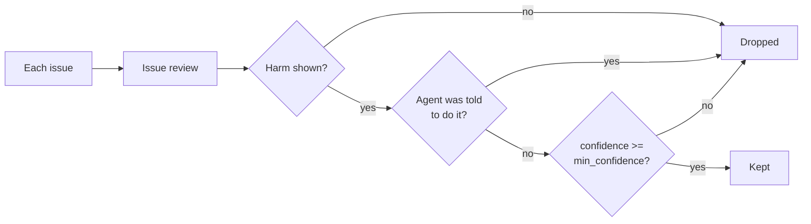

<ClassifierTagsDisplayer custom={true} singleTurn={true} multiTurn={true} />

The `IssueClassifier` in `deepeval` finds the problems your AI agent caused in a test case, conversation or trace: wrong or made-up information, ignored tool results, failed tool calls, broken output, unanswered requests. It returns every issue it finds, each with the passages that show it, and verifies each one before keeping it.

It is a [`Classifier`](/docs/classifiers-custom) with issue-specific prompts and multi-label classification, evidence and review turned on.

:::info
This is most useful for **monitoring agents in production**, where you want a list of what went wrong in each interaction rather than a single category.
:::

## Usage

```python
from deepeval.classifiers import IssueClassifier, Label
from deepeval.test_case import LLMTestCase

classifier = IssueClassifier(
    name="agent failures",
    labels=[
        Label(name="Wrong Refund Window", description="States a refund window that differs from the policy."),
        Label(name="Ignored Tool Result", description="Contradicts or ignores what a tool returned."),
    ],
)

test_case = LLMTestCase(
    input="What's the refund window?",
    actual_output="Refunds close after 7 days.",
    retrieval_context=["Refunds are accepted within 30 days of purchase."],
)

classifier.classify(test_case)
for issue in classifier.classifications:
    print(issue.label, issue.confidence, "-", issue.reason)
```

Which prints:

```text
Wrong Refund Window 0.93 - The agent said refunds close after 7 days, but the policy allows 30.
```

There are **ONE** mandatory and **ELEVEN** optional parameters when creating an `IssueClassifier`:

- `name`: a string that identifies the classifier.
- [Optional] `labels`: a list of `Label`s or plain strings naming the issues to look for. May be left empty when a `label_discovery_config` is set. Defaulted to `[]`.
- [Optional] `description`: a string saying what the classifier looks for. Defaulted to `None`.
- [Optional] `model`: a string specifying which of OpenAI's GPT models to use, **OR** [any custom LLM model](/guides/guides-using-custom-llms) of type `DeepEvalBaseLLM`. Defaulted to <DefaultLLMModel />.
- [Optional] `include_reason`: a boolean which when set to `True`, includes a reason for each issue. Defaulted to `True`.
- [Optional] `async_mode`: a boolean which when set to `True`, enables [concurrent execution within the `classify()` method](/docs/classifiers-introduction#using-classifiers-async). Defaulted to `True`.
- [Optional] `classification_template`: a subclass of `IssueClassifierTemplate` used to [override the default prompts](#customize-your-template). Defaulted to `IssueClassifierTemplate`.
- [Optional] `max_content_chars`: the most characters of content sent to the judge. Defaulted to `100000`.
- [Optional] `evidence_config`: an [`EvidenceConfig`](/docs/classifiers-custom#evidence). Defaulted to `EvidenceConfig()`.
- [Optional] `review_config`: a [`ReviewConfig`](/docs/classifiers-custom#review); its `min_confidence` is the issue threshold. Defaulted to `ReviewConfig()`.
- [Optional] `label_discovery_config`: a [`LabelDiscoveryConfig`](/docs/classifiers-custom#label-discovery) to find issues you have not named yet. Defaulted to `None`.
- [Optional] `classification_context`: a [`ClassificationContext`](/docs/classifiers-custom#classification-context). With an `app_description`, behaviour the application was designed to have is not flagged. Defaulted to `None`.

An `IssueClassifier` always returns every issue it finds (`multi_label=True`), and returns none for a correct, complete response (`allow_none=True`).

### Discovering issues

To find issues you have not named, start with no labels and a `LabelDiscoveryConfig`:

```python
from deepeval.classifiers import IssueClassifier, LabelDiscoveryConfig

classifier = IssueClassifier(
    name="agent failures",
    label_discovery_config=LabelDiscoveryConfig(max_new_labels=3),
)
```

Discovered issues are named in 3 to 7 words that say exactly what happened, such as "Agent Audio Cut Mid Sentence", and merged with near-duplicates as described in [label discovery](/docs/classifiers-custom#label-discovery). `max_new_labels` caps how many new issues one test case can add.

## How Does It Work?

An `IssueClassifier` runs the same steps as a [`Classifier`](/docs/classifiers-custom#how-does-it-work), with three differences:

- **Issue guidance**: the judge is told to flag only failures on the agent's side, never the user's behaviour, and to return nothing for a correct, complete response.
- **Issue review**: each issue is re-judged for real harm, and kept only if harm is shown, the agent was not told to do it, and its confidence is at least `min_confidence`.
- **Truncation check**: an issue whose only evidence is the `…[truncated]` marker added to shortened content is dropped, since the marker is not the agent's output.

### Issue review

The review reads the content on its own and fills in what happened, a `harm` passage showing someone got something wrong, broken or not delivered, and any `instruction` that told the agent to behave that way:



A dropped issue explains itself in `reason`, for example: `Proposed "Wrong Refund Window" but review dropped it. The agent was told to do this: "Always quote 7 days". The script required it.`

## Customize Your Template

`IssueClassifierTemplate` overrides these prompts of `ClassifierTemplate` and inherits the rest:

- `issue_guidance()`: the paragraph that tells the judge what counts as an issue.
- `label_naming_rule()`: how discovered issues are named.
- `review_label(subject: str, label: str, content: str, app_description: str, app_note: str)`: the issue review, which must keep asking for JSON with `what_happened`, `harm`, `instruction`, `confidence` and `reason` fields.

- `review_app_note()`: how the review treats behaviour the `app_description` says was designed.

Subclass `IssueClassifierTemplate` to change any of them, and pass it as `classification_template`.
