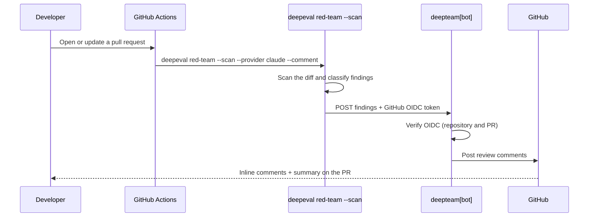

`deepeval` can review every pull request and comment its findings as **`deepteam[bot]`**. By default the scan runs through **Claude Code** (the Claude Agent SDK) using your `ANTHROPIC_API_KEY`, and the comment is posted by the bot through GitHub Actions [OIDC](https://docs.github.com/en/actions/deployment/security-hardening-your-deployments/about-security-hardening-with-openid-connect), so there are no bot tokens to store.

:::info
The workflow only needs `contents: read` and `id-token: write`, not `pull-requests: write`. The comment is posted server-side by the bot, and the OIDC token is bound to the exact repository and pull request the workflow ran for.
:::

## Quick Summary

There are **TWO** ways to set up the bot:

- [Hosted GitHub App](/docs/code-scanning-github-bot#hosted-github-app) - install the app and it configures everything for you.
- [Manual Setup](/docs/code-scanning-github-bot#manual-setup) - add the scan workflow to your repository yourself.

Both run the scan through **Claude Code** by default, which is the recommended provider. To use Codex, Cursor, or the built-in native scanner instead, see [Choosing a Provider](/docs/code-scanning-github-bot#choosing-a-provider).

## How It Works

The scan runs in your own CI and sends its findings to the bot, so the comment appears from `deepteam[bot]` with no bot token stored in your repo. Authentication uses the GitHub Actions OIDC token, which the bot verifies is bound to this repository and pull request before commenting.



## Hosted GitHub App

The quickest path is the hosted DeepTeam GitHub App, which sets everything up for you:

1. Install the app at [github.com/apps/deepteam](https://github.com/apps/deepteam), selecting the repositories you want scanned.
2. Enter your email when redirected. The bot automatically opens a pull request that adds the scan workflow to each repository, configured for the **Claude Code** provider.
3. Merge that pull request and add an `ANTHROPIC_API_KEY` [repository secret](https://docs.github.com/en/actions/security-guides/using-secrets-in-github-actions).

From then on, every pull request is scanned and commented on automatically.

## Manual Setup

If you'd rather not use the hosted onboarding, you can commit the workflow yourself:

```yaml title=".github/workflows/deepeval-code-scan.yml"
name: DeepEval Code Scan

on:
  pull_request:
    types: [opened, synchronize, ready_for_review]

permissions:
  contents: read
  id-token: write

jobs:
  scan:
    runs-on: ubuntu-latest
    steps:
      - uses: actions/checkout@v4
        with:
          fetch-depth: 0
      - uses: actions/setup-python@v5
        with:
          python-version: "3.12"
      - run: pip install "deepeval[claude-code]"
      - name: Scan & comment as deepteam[bot]
        env:
          ANTHROPIC_API_KEY: ${{ secrets.ANTHROPIC_API_KEY }}
        run: deepeval red-team --scan . --provider claude-code --diff "origin/${{ github.base_ref }}..HEAD" --comment
```

Then add an `ANTHROPIC_API_KEY` repository secret and install the [DeepTeam GitHub App](https://github.com/apps/deepteam) on the repository so the bot is authorized to comment.


## Choosing a Provider

Claude Code is the default and recommended provider, but you can delegate the scan to another agentic harness (Codex or Cursor). Each provider uses its own SDK extra and API key:

| Provider | Install | API key |
| --- | --- | --- |
| `claude-code` (default) | `pip install "deepeval[claude-code]"` | `ANTHROPIC_API_KEY` |
| `codex` | `pip install "deepeval[codex]"` | `OPENAI_API_KEY` |
| `cursor` | `pip install "deepeval[cursor]"` | `CURSOR_API_KEY` |

If you don't select a provider, `deepeval` falls back to its built-in native scanner, which runs on the OpenAI API (`pip install deepeval` with an `OPENAI_API_KEY`).

To switch, change the workflow's install line, the API key, and the `--provider` flag. For example, to use Codex:

```yaml
      - run: pip install "deepeval[codex]"
      - name: Scan & comment as deepteam[bot]
        env:
          OPENAI_API_KEY: ${{ secrets.OPENAI_API_KEY }}
        run: deepeval red-team --scan . --provider codex --diff "origin/${{ github.base_ref }}..HEAD" --comment
```

You can also pin the provider and model in `.deepeval-code-scan.yaml` instead of passing flags:

```yaml title=".deepeval-code-scan.yaml"
provider: claude-code
model: claude-sonnet-4-5
```

The `model` is provider-specific (e.g. `claude-sonnet-4-5` for Claude Code, `gpt-5.4` for Codex, `composer-2.5` for Cursor). See [provider and model configuration](/docs/code-scanning-introduction#configuration-file) for all options, and the [runnable example](https://github.com/confident-ai/deepeval/blob/main/examples/code_scan_harness_example.py) for trying each provider locally.
