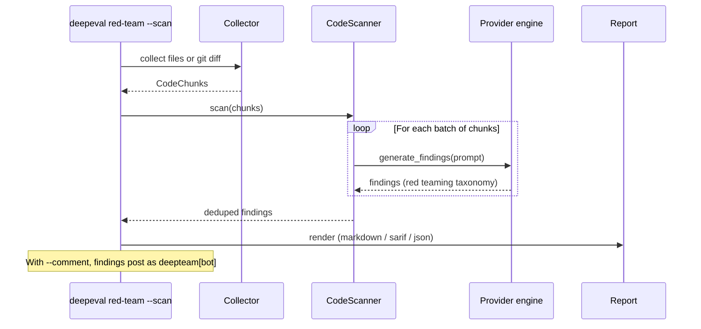

`deepeval` offers a powerful way to statically scan your source code for AI-application security vulnerabilities. Instead of attacking a running system like [red teaming](/docs/red-teaming-introduction) does, code scanning reads your source files and flags risky constructs such as `eval` or `exec` on LLM output, prompt injection sinks, SSRF, and excessive agency.

:::info
Code scanning is built on the same vulnerability taxonomy as red teaming. Every finding is classified into one of `deepeval`'s [vulnerabilities](/docs/red-teaming-vulnerabilities), so the two interfaces share the same vocabulary.
:::

## Quick Summary

Code scanning can be run in 4 different ways:

- [Command Line](/docs/code-scanning-introduction#running-a-scan) - scan a file, directory, or git diff from the CLI.
- [Configuration File](/docs/code-scanning-introduction#configuration-file) - declare your scan settings in `.deepeval-code-scan.yaml`.
- [Python API](/docs/code-scanning-introduction#python-api) - run the scanner programmatically for full control.
- [GitHub Bot](/docs/code-scanning-github-bot) - comment findings on every pull request as `deepteam[bot]`.

Here's how you can run a scan on the current directory:

```bash
deepeval red-team --scan .
```

By default the report is printed as Markdown and the command exits with code `1` if any findings remain, which makes it a ready-made CI gate.

:::tip[DID YOU KNOW?]
Code scanning is particularly useful for **CI/CD pipelines**, where you want to catch AI-security issues on every pull request before they are merged.
:::

## How It Works

`deepeval red-team --scan` collects your code (whole files or just a git diff), batches it, sends each batch to the chosen [provider](/docs/code-scanning-github-bot#choosing-a-provider), and maps every result into `deepeval`'s vulnerability taxonomy. It then renders a report and, optionally, comments on your pull request.



## Running a Scan

The `deepeval red-team --scan` command takes a `path` argument, which can be a file or a directory and is defaulted to `.`.

### Basic Usage

```bash
deepeval red-team --scan .
```

### Scanning a Git Diff

Use the `--diff` flag to scan only the files changed between two git refs, which is ideal for pull request checks:

```bash
deepeval red-team --scan . --diff "main..HEAD"
```

### Command Line Flags

There are **NINE** optional command line flags:

- [Optional] `--diff`: scan only files changed between two git refs, e.g. `"main..HEAD"`.
- [Optional] `-c`, `--config`: path to a config YAML. Auto-discovered at the scan root if not set.
- [Optional] `-f`, `--format`: output format, one of `markdown`, `sarif`, or `json`. Defaulted to `markdown`.
- [Optional] `--min-severity`: only report findings at or above `low`, `medium`, `high`, or `critical`.
- [Optional] `-p`, `--provider`: scan engine, one of `codex`, `claude-code`, or `cursor`. Defaulted to the provider inferred from the API key that is set; if none is available, `deepeval` uses its built-in native scanner (OpenAI API).
- [Optional] `-m`, `--model`: model for the chosen provider, e.g. `gpt-4o`. Overrides the config.
- [Optional] `-o`, `--output`: write the report to a file instead of stdout.
- [Optional] `--fail-on-findings` / `--no-fail-on-findings`: exit with code `1` if any findings remain. Defaulted to `True`.
- [Optional] `--comment`: post findings so `deepteam[bot]` comments on the pull request, see [GitHub Bot](/docs/code-scanning-github-bot).

## Output Formats

Pick the report format with `-f` / `--format`, which defaults to `markdown`:

- `markdown`: a human-readable report grouped by file, with a severity badge and a suggested fix per finding. This is what the [GitHub bot](/docs/code-scanning-github-bot) posts on a pull request.
- `sarif`: SARIF 2.1.0, for security dashboards such as GitHub code scanning (upload it with the `github/codeql-action/upload-sarif` action).
- `json`: the raw findings, for custom tooling or storage.

Use `-o` to write the report to a file instead of stdout:

```bash
deepeval red-team --scan . --format sarif --output results.sarif
```

## Configuration File

You can declare your scan settings in a `.deepeval-code-scan.yaml` file at your scan root, which is picked up automatically.

```yaml title=".deepeval-code-scan.yaml"
min_severity: medium

instruction: |
  This is a customer-support agent. Treat hardcoded API keys and any
  eval/exec on LLM output as critical.

exclude:
  - "tests/**"

# Optional: delegate the scan to an agentic harness instead of the built-in
# judge. Omit both to auto-detect from the API key that is set.
# provider: codex
# model: gpt-4o
```

There are **EIGHT** optional parameters when creating a code scan configuration:

- [Optional] `min_severity`: minimum severity to report, one of `low`, `medium`, `high`, or `critical`. Defaulted to `low`.
- [Optional] `instruction`: project-specific guidance passed to the scanner. Defaulted to `None`.
- [Optional] `include`: glob patterns a file must match to be scanned. Defaulted to `None`.
- [Optional] `exclude`: glob patterns to skip. Defaulted to `None`.
- [Optional] `vulnerabilities`: restrict the scan to a subset of vulnerability names. Defaulted to a curated set of code-visible categories.
- [Optional] `provider`: scan engine, one of `codex`, `claude-code`, or `cursor`. Defaulted to the provider inferred from the API key that is set; if none is available, `deepeval` uses its built-in native scanner (OpenAI API).
- [Optional] `model`: default model for the chosen provider. Defaulted to `None`.
- [Optional] `diffs_only`: only scan changed files. Defaulted to `False`.

To run the scan through an agentic harness instead of the built-in native scanner, set `provider` to `codex`, `claude-code`, or `cursor` and install the matching extra (for example `pip install deepeval[codex]`). If you only set the API key (`OPENAI_API_KEY`, `ANTHROPIC_API_KEY`, or `CURSOR_API_KEY`), the provider is auto-detected, so no config change is needed.

## Python API

For full control, you can use the scanner programmatically. Create a `code_scan_example.py` file and paste the following code:

```python title="code_scan_example.py"
from deepeval.red_team.code_scanner import CodeScanner, collect_files

# Collect scannable chunks from a path (binaries and lockfiles are skipped)
chunks = collect_files(".", exclude=["tests/**"])

scanner = CodeScanner(
    model="gpt-4o",
    instruction="This is a customer-support agent.",
)
findings = scanner.scan(chunks)

for finding in findings:
    print(finding.severity, f"{finding.filePath}:{finding.lineStart}", finding.vulnerability)
```

To scan only what changed between two git refs, use `collect_changed_files` instead:

```python title="code_scan_example.py"
from deepeval.red_team.code_scanner import CodeScanner, collect_changed_files

chunks = collect_changed_files(".", base="main", head="HEAD")
findings = CodeScanner(model="gpt-4o").scan(chunks)
```

Each finding carries `filePath`, `lineStart`, `lineEnd`, `vulnerability`, `vulnerabilityType`, `severity`, `reason`, and `recommendation`. The helpers `to_markdown`, `to_sarif`, `to_json`, and `filter_by_severity` are also available from `deepeval.red_team.code_scanner` for rendering and filtering.

:::info
You'll need to set your `OPENAI_API_KEY` as an environment variable before running a scan, since `deepeval` uses an LLM to detect and classify vulnerabilities. To use **ANY** custom LLM of your choice, [check out this part of the docs](/guides/guides-using-custom-llms).
:::
