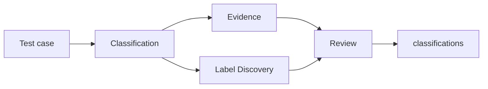
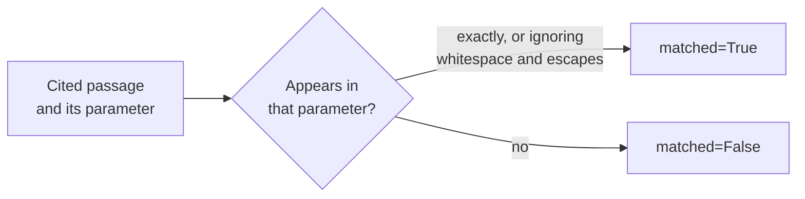
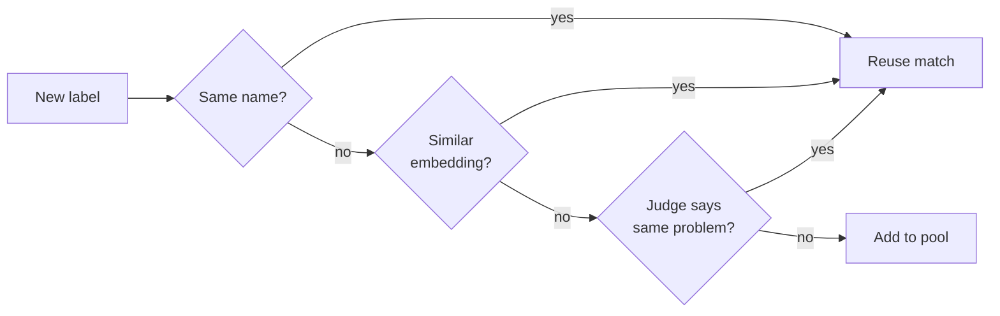
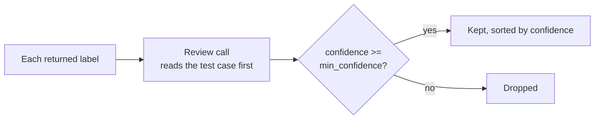

<ClassifierTagsDisplayer jev={true} custom={true} singleTurn={true} multiTurn={true} />

The `Classifier` in `deepeval` is a categorical LLM-as-a-judge that assigns one label from a set you define to any single-turn or multi-turn test case. It is the class every [built-in classifier](/docs/classifiers-refusal) is built on, and the one to reach for when the labels are specific to your application: topic, intent, product area, escalation category, or anything else you can name.

The whole classifier is the label set, so writing good labels is most of the work.

## Usage

```python
from deepeval.classifiers import Classifier, Label
from deepeval.test_case import LLMTestCase
from deepeval import evaluate

classifier = Classifier(
    name="topic",
    labels=[
        Label(name="billing", description="Questions about invoices, charges, or payment methods."),
        Label(name="refund", description="Requests to get money back for a purchase that has already been made."),
        Label(name="shipping", description="Questions about delivery status, times, or addresses."),
    ],
)

test_case = LLMTestCase(
    input="I was charged twice this month.",
    actual_output="Sorry about that. I can see the duplicate charge and will reverse it.",
    expected_labels={classifier.name: "billing"},
)

evaluate(test_cases=[test_case], classifiers=[classifier])
```

There are **TWO** mandatory and **FOURTEEN** optional parameters when creating a `Classifier`:

- `name`: a string that identifies the classifier. It is the key a test case uses in `expected_labels`, so it must be unique within a run.
- `labels`: a list of `Label`s or plain strings. At least one is required and names must be unique.
- [Optional] `description`: a string saying what the classifier is for. When set, the judge is told the classifier's name and purpose. Defaulted to `None`.
- [Optional] `model`: a string specifying which of OpenAI's GPT models to use, **OR** [any custom LLM model](/guides/guides-using-custom-llms) of type `DeepEvalBaseLLM`. Defaulted to <DefaultLLMModel />.
- [Optional] `include_reason`: a boolean which when set to `True`, includes a reason for the chosen label. Defaulted to `True`.
- [Optional] `async_mode`: a boolean which when set to `True`, enables [concurrent execution within the `classify()` method](/docs/classifiers-introduction#using-classifiers-async). Defaulted to `True`.
- [Optional] `classification_template`: a subclass of `ClassifierTemplate` used to [override the default prompts](#customize-your-template). Defaulted to `ClassifierTemplate`.
- [Optional] `system_one_model`: the Jev model to use, as a string or a `DeepEvalBaseSystemOneModel`. Only used under the `system_one` `eval_mode`. Defaulted to <DefaultSystemOneModel />.
- [Optional] `eval_mode`: `llm` or `system_one`, choosing whether an LLM or Jev picks the label. Defaulted to the configured [eval mode](/docs/evaluation-eval-modes) (`llm` unless set).
- [Optional] `allow_none`: a boolean which when set to `True`, lets the classifier return no label when none of them fit (surfaced as `label=None`, with a reason). When `False`, the closest label is always chosen. Defaulted to `False`.
- [Optional] `multi_label`: a boolean which when set to `True`, returns [every label that applies](#multi-label-classification) instead of exactly one. Defaulted to `False`.
- [Optional] `max_content_chars`: the most characters of test case content sent to the judge; longer content is [truncated](#classification). Defaulted to `100000`.
- [Optional] `evidence_config`: an `EvidenceConfig` that makes the judge [cite the passages](#evidence) that show each label applies. Defaulted to `None` (off).
- [Optional] `review_config`: a `ReviewConfig` that [re-checks every label](#review) in a second judge call and gives it a `confidence`. Defaulted to `None` (off).
- [Optional] `label_discovery_config`: a `LabelDiscoveryConfig` that lets the judge [propose new labels](#label-discovery) when none of yours fit. Defaulted to `None` (off).
- [Optional] `classification_context`: a [`ClassificationContext`](#classification-context) describing the application being classified. Defaulted to `None`.

The same `Classifier` also accepts a `ConversationalTestCase`, in which case it reads every turn along with the scenario and expected outcome, and an `LLMTestCase` that carries a trace, in which case it reads every span as well.

:::note
`multi_label` and the three configs need an LLM judge, so they cannot be combined with the `system_one` eval mode.
:::

:::tip
If you leave `expected_labels` off the test case, the classification is still recorded but does not pass or fail the case; see [expected labels](/docs/classifiers-introduction#expected-labels) in the introduction.
:::

### As a standalone

You can also run a `Classifier` on a single test case as a standalone, one-off execution. `classify()` returns the label and stores the result on the instance:

```python
...

label = classifier.classify(test_case)
print(classifier.label, classifier.reason)
```

## Writing Good Labels

This is the data model of a `Label`:

```python
from pydantic import BaseModel

class Label(BaseModel):
    name: str
    description: Optional[str] = None
```

Which can be used in a classifier as such:

```python
from deepeval.classifiers import Classifier, Label

urgency = Classifier(
    name="urgency",
    labels=[
        Label(name="urgent", description="The user needs a response within the hour or is blocked from working."),
        Label(name="routine", description="The user can wait; no deadline or blocker is mentioned."),
    ],
)
```

A label's description is the boundary the judge uses to decide, in the same way that G-Eval's criteria are the boundary for a score. Three things make a label set work well:

- **Make labels mutually exclusive.** Unless `multi_label` is set, the judge picks exactly one, so overlapping labels give inconsistent results between runs.
- **Describe the edge, not the centre.** "Questions about billing" adds nothing to the name; "invoices, charges, or payment methods, but not requests for money back" tells the judge where billing stops and refund starts.
- **Decide what happens when nothing fits.** The judge picks the closest label by default. If some responses genuinely match none, set `allow_none=True` rather than adding an "other" label.

Plain strings are fine when the name is unambiguous on its own:

```python
from deepeval.classifers import Classifier

sentiment = Classifier(name="sentiment", labels=["positive", "neutral", "negative"])
```

## Classification Context

Pass a `ClassificationContext` to tell the judge what application it is looking at, so it reasons from that application's point of view:

```python
from deepeval.classifiers import Classifier, ClassificationContext

classifier = Classifier(
    name="topic",
    labels=["billing", "refund"],
    description="What the customer wants to talk about.",
    classification_context=ClassificationContext(
        app_description="A billing assistant for a SaaS product.",
        trace_description="Each trace is one support chat.",
    ),
)
```

There are **TWO** optional parameters when creating a `ClassificationContext`:

- [Optional] `app_description`: what the application is and does. The review also uses it to tell designed behaviour apart from mistakes. Defaulted to `None`.
- [Optional] `trace_description`: what one test case or trace represents. Defaulted to `None`.

With a `ClassificationContext` but neither description, the judge is told to infer the application's use case from the content.

## Multi-Label Classification

By default a `Classifier` picks exactly one label. Set `multi_label=True` when one test case can match several, such as a trace that both quotes the wrong price and ignores a tool result:

```python
from deepeval.classifiers import Classifier, Label
from deepeval.test_case import LLMTestCase, ToolCall

test_case = LLMTestCase(
    input="How much is the Pro plan?",
    actual_output="The Pro plan is $99 a month.",
    tools_called=[ToolCall(name="get_price", output="Pro: $20/month")],
)

failures = Classifier(
    name="failures",
    labels=[
        Label(name="wrong_price", description="The response states a price that differs from the pricing tool's result."),
        Label(name="ignored_tool", description="The response contradicts or ignores what a tool returned."),
    ],
    multi_label=True,
    allow_none=True,
)

failures.classify(test_case)
for result in failures.classifications:
    print(result.label, "-", result.reason)
```

Which prints:

```text
wrong_price - The response says Pro costs $99 a month, but get_price returned $20.
ignored_tool - The response ignores the price the get_price tool returned.
```

`classifications` holds one `Classification` per matching label, most certain first, each with its own `label`, `reason`, `evidence`, `confidence` and `new_label_description`. In single-label mode it holds at most one, and `label` and `reason` are shortcuts to it. A test case with an `expected_labels` entry passes when the expected label is any of the `classifications`.

## How Does It Work?

A `Classifier` runs a short pipeline over each test case. Classification always runs; each config adds its own step:

- **Classification**: one judge call picks the label, or every matching label with `multi_label`, after long content is shortened to `max_content_chars`.
- **Evidence** (`evidence_config`): each label cites the test case passages that support it, checked to really appear there.
- **Label Discovery** (`label_discovery_config`): proposes a new label when none fit, merged with similar existing ones.
- **Review** (`review_config`): a second call per label verifies it and drops low-confidence ones, for higher precision.



Leaving a config as `None` skips its step, so the prompt and the number of judge calls stay exactly as without it.

:::info
In summary, one judge call picks the labels, their quotes are checked and any new labels are merged, and an optional second call per label scores and filters them.
:::

The examples below all classify this test case:

```python
from deepeval.test_case import LLMTestCase

test_case = LLMTestCase(
    input="I was charged twice this month, can I get one of them back?",
    actual_output="Sorry about that. I've reversed the duplicate charge.",
)
```

The outputs shown are what a typical judge returns; the exact wording varies by model.

### Classification

One judge call reads the test case and your labels, and picks the best one. Content longer than `max_content_chars` is shortened first, which matters most for long traces: span fields are capped at 1,500 characters, the most important spans are kept (errored first), and conversations keep their latest turns:

```python
from deepeval.classifiers import Classifier

classifier = Classifier(name="topic", labels=["billing", "refund", "shipping"])
classifier.classify(test_case)

print(classifier.label, "-", classifier.reason)
```

Which prints:

```text
refund - The user asks for one of two duplicate charges back and the assistant reverses it.
```

With `multi_label=True`, the same call returns every label that applies, most certain first, one `Classification` each:

```python
classifier = Classifier(
    name="topic", labels=["billing", "refund", "shipping"], multi_label=True
)
classifier.classify(test_case)

for classification in classifier.classifications:
    print(classification.label, "-", classification.reason)
```

Which prints:

```text
refund - The user asks for one of two duplicate charges back and the assistant reverses it.
billing - The user reports being charged twice this month.
```

The judge's answer must be one of your labels (ignoring case); anything else is recorded as an error rather than guessed at, unless a `label_discovery_config` is set. With `allow_none=True` it may return no label, which gives `label=None` and an empty `classifications`. A test case that carries a trace is shown with its spans, and the judge is told to weigh the work done inside them, not just the final answer.

If the test case has an `expected_labels` entry for this classifier, it passes when the expected label is among the `classifications`. Results are cached like metrics, keyed on the classifier's name, labels, `model` and options; classifiers with a `label_discovery_config` are never cached, since they keep state between calls.

Under the `system_one` [eval mode](/docs/evaluation-eval-modes), Jev, a System One model, decides the label instead, as one choice over your labels using each description as its boundary. The reason is built from Jev's per-label probabilities, no LLM is used, and Jev errors are raised. `system_one` needs `TYPESAFE_API_KEY` set and the [SDK installed](/integrations/models/typesafe-ai#setting-up-your-api-key), and cannot be combined with `multi_label` or the configs.

### Evidence

With an `EvidenceConfig`, every label cites the passages from the test case that support it, in the same judge call:

```python
from deepeval.classifiers import Classifier, EvidenceConfig

classifier = Classifier(
    name="topic",
    labels=["billing", "refund"],
    evidence_config=EvidenceConfig(max_items=3, max_quote_chars=300),
)
classifier.classify(test_case)

for item in classifier.classifications[0].evidence:
    print(item.field, "|", item.quote, "|", item.matched)
    print("  ", item.note)
```

Which prints:

```text
input | can I get one of them back? | True
   The user asks for one of two duplicate charges to be returned.
actual_output | I've reversed the duplicate charge. | True
   The assistant confirms it refunded the duplicate charge.
```

`deepeval` then looks each passage up in the parameter it was cited from. Both passages above appear word for word, so both are `matched=True`. Had the judge cited "I refunded both charges" from `actual_output`, a sentence the reply never says, that item would still be returned, but with `matched=False`. The same goes for a real passage cited from the wrong parameter.

There are **TWO** optional parameters when creating an `EvidenceConfig`:

- [Optional] `max_items`: the most passages the judge cites per label. Defaulted to `3`.
- [Optional] `max_quote_chars`: the longest a quote may be; longer quotes are cut. Defaulted to `300`.

Each item in a `Classification`'s `evidence` list looks like this:

```python
Evidence(
    field="input",                     # the test case parameter it was cited from
    quote="can I get one of them back?",
    note="The user asks for one of two duplicate charges to be returned.",
    turn_index=None,                   # the turn, for a ConversationalTestCase
    span_index=None,                   # the span, for a test case with a trace
    matched=True,                      # False if the quote isn't in that parameter
)
```



### Label Discovery

With a `LabelDiscoveryConfig`, the judge proposes a new label, with a description, when none of yours fit. New labels are remembered for later test cases:

```python
from deepeval.classifiers import Classifier, Label, LabelDiscoveryConfig
from deepeval.test_case import LLMTestCase

topics = Classifier(
    name="topics",
    labels=[Label(name="Pricing", description="Questions about what a plan or product costs.")],
    label_discovery_config=LabelDiscoveryConfig(
        candidate_labels=[Label(name="Plan Upgrade", description="Requests to move to a higher plan.")],
    ),
    allow_none=True,
)

topics.classify(LLMTestCase(input="Do you offer a discount for nonprofits?"))
print(topics.label)
print(topics.classifications[0].new_label_description)
print([label.name for label in topics.candidate_labels])
```

Which prints a new label, now remembered in the pool:

```text
Nonprofit Discount
Conversations where the user asks whether a discount exists for nonprofit or charitable organisations. Does not apply when the user asks about general pricing or other discounts.
['Plan Upgrade', 'Nonprofit Discount']
```

A later test case that describes an existing label in other words is merged into it instead of adding a near-duplicate:

```python
topics.classify(LLMTestCase(input="Can we move the whole team onto the Business tier?"))
print(topics.label)
print(topics.classifications[0].new_label_description)
print([label.name for label in topics.candidate_labels])
```

The judge proposed "Team Tier Change", but merging found it is the same as the candidate, so it prints:

```text
Plan Upgrade
Requests to move to a higher plan.
['Plan Upgrade', 'Nonprofit Discount']
```

There are **FOUR** optional parameters when creating a `LabelDiscoveryConfig`:

- [Optional] `candidate_labels`: a list of `Label`s or strings proposed earlier but not adopted yet, used to seed the classifier's label pool. Defaulted to `[]`.
- [Optional] `embedding_model`: a string or any `DeepEvalBaseEmbeddingModel`, used to [merge near-duplicates](#label-discovery) by similarity before asking the judge. Defaulted to `None`, which shortlists by shared words instead.
- [Optional] `similarity_threshold`: the cosine similarity at or above which a new label is merged into an existing one without asking the judge. Only used with an `embedding_model`. Defaulted to `0.92`.
- [Optional] `top_k`: how many of the most similar existing labels the judge compares a new label against when deciding whether to merge it. Defaulted to `15`.

On each `Classification`, `new_label_description` is `None` for one of your labels, and is set for a new or candidate label. A suggested name that only says nothing applies, such as "Other" or "No Topic", is treated as no label.

The classifier remembers what it suggests. Every new label joins its label pool, available as `classifier.candidate_labels`, and later calls show the pool to the judge so it reuses a name instead of inventing another. The pool is shared by every copy of the classifier, including the copies `evaluate()` runs in parallel, and lives as long as the classifier does. To carry it across runs, pass the previous `classifier.candidate_labels` to the next classifier's `LabelDiscoveryConfig`.

**Merging near-duplicates**

Before a new label joins the pool it is compared with your labels and the pool, so parallel test cases that describe the same problem in different words end up on one name:



1. A label with the same name (ignoring case) is reused as-is.
2. With an `embedding_model`, the closest labels by name similarity are found; one at or above `similarity_threshold` is reused without further checks.
3. Otherwise the judge compares it against the `top_k` most similar labels and picks the one whose fix would also fix the proposed problem, or none.
4. Only when nothing matches is the new label added to the pool.

A match to one of your labels returns that label with no `new_label_description`; a match to a pool label returns it with its description.

### Review

With a `ReviewConfig`, a second judge call per label verifies it and scores it from 0 to 1. Labels below `min_confidence` are dropped, for fewer but more precise labels:

```python
from deepeval.classifiers import Classifier, ReviewConfig

classifier = Classifier(
    name="topic",
    labels=["billing", "refund", "shipping"],
    multi_label=True,
    review_config=ReviewConfig(min_confidence=0.6),
)
classifier.classify(test_case)

for classification in classifier.classifications:
    print(classification.label, classification.confidence)
```

Suppose the first call returned `refund`, `billing` and `shipping`. The review keeps the first two and drops `shipping`, which nothing in the test case supports, so it prints:

```text
refund 0.92
billing 0.71
```

Had every label been dropped, `classifier.label` would be `None` and `classifier.reason` would read like `Proposed "shipping" but review dropped it. Nothing in the test case is about delivery.`

There is **ONE** optional parameter when creating a `ReviewConfig`:

- [Optional] `min_confidence`: a float between 0 and 1; labels the review scores below it are dropped. Defaulted to `0.6`.



- Every `Classification` gets a `confidence`, and `classifications` is sorted by it, most confident first.
- Labels below `min_confidence` are dropped. When every label is dropped, `label` is `None` with no error, and `reason` says which label was proposed and why the review dropped it.
- The review sees the label's description and, with an `evidence_config`, the passages the first call cited.
- A review whose reply cannot be read keeps the label, with `confidence=None`.

Reviewing costs one extra judge call per returned label, made in parallel under `async_mode`.

## Customize Your Template

You can override the default prompts by subclassing `ClassifierTemplate` and passing it as `classification_template`. These are the prompts you can override:

- `classify_single_turn(labels: str, test_case_content: str)`
- `classify_multi_turn(labels: str, test_case_content: str, turns: list)`
- `classify_trace(labels: str, trace_content: str)`
- `classification_context(name: str, description: str, has_context: bool, app_description: str, trace_description: str)`
- `reason_rules()`
- `cite_evidence(subject: str, fields: str, allow_none: bool, max_items: int, max_quote_chars: int)`
- `suggest_labels(allow_none: bool, candidate_labels: bool, label_naming_rule: str)`
- `label_naming_rule()`
- `merge_labels(payload: str)`, which must keep asking for JSON with a `same_as` field
- `review_label(subject: str, label: str, content: str, app_description: str, app_note: str)`, which must keep asking for JSON with `summary`, `confidence` and `reason` fields
- `review_app_note()`

`labels` is the rendered list of label names and descriptions, `test_case_content` the rendered test case fields, and `turns` a list of dicts with the populated fields of each turn. The three `classify_*` prompts also receive the rendered `context`, `guidance`, `reason_rules`, `cite_evidence`, `suggest_labels` and `candidate_labels`, and `multi_label`. An override only needs to declare the variables it uses, and must keep asking for JSON with `label` and `reason` fields.

```python
from deepeval.classifiers import Classifier, ClassifierTemplate
import textwrap

class StrictClassifierTemplate(ClassifierTemplate):
    @staticmethod
    def classify_single_turn(labels: str, test_case_content: str) -> str:
        return textwrap.dedent(
            f"""
            Pick exactly one label for the test case below. Prefer the most
            specific label.

            Labels:
            {labels}

            Test case:
            {test_case_content}

            Return JSON only: {{"label": "...", "reason": "..."}}
            JSON:
            """
        )

classifier = Classifier(
    name="topic",
    labels=["billing", "refund", "shipping"],
    classification_template=StrictClassifierTemplate,
)
```

:::tip
The default templates live under [`deepeval/classifiers/classifier/templates/`](https://github.com/confident-ai/deepeval/tree/main/deepeval/classifiers/classifier/templates) on GitHub. Start from those when writing your own.
:::

## FAQs

<FAQs
  qas={[
    {
      question: "Can a classifier return more than one label?",
      answer: (
        <>
          Yes, set <code>multi_label=True</code>. Every matching label is
          returned in <code>classifications</code>, most certain first, and{" "}
          <code>label</code> holds the first one.
        </>
      ),
    },
    {
      question: "What happens when none of my labels fit?",
      answer: (
        <>
          By default the judge picks the closest label and explains the
          reservation in its reason. Set <code>allow_none=True</code> if you
          would rather it return no label in that situation; the classification
          then has <code>label=None</code>, no error, and fails only if the test
          case expected a specific label.
        </>
      ),
    },
    {
      question:
        "Why does my classifier error instead of picking the closest label?",
      answer: (
        <>
          Matching is exact (ignoring case) against your declared labels. If the
          judge invents a label, <code>deepeval</code> records an error rather
          than guessing which of your labels it meant. This usually means two
          labels overlap or a description is vague; tighten the descriptions
          before reaching for a custom template.
        </>
      ),
    },
  ]}
/>
