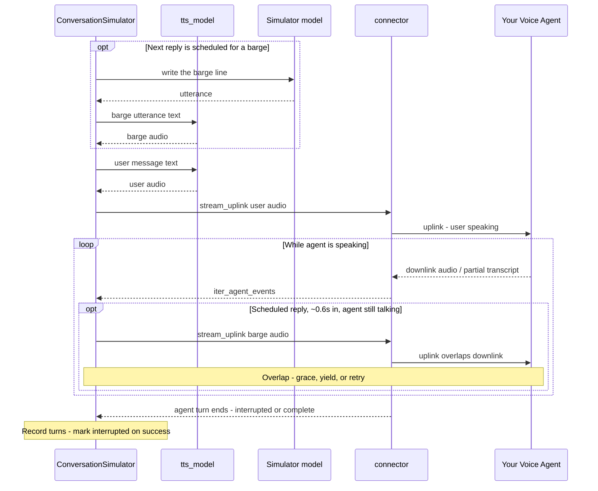

By default the simulated caller never interrupts: it finishes speaking, then waits for the agent to finish before replying. Give the caller's [persona](/docs/conversation-simulator-voice-personas) an `interruption_behavior` to exercise barge-in — the same connector session, driven with concurrent uplink and downlink, with the caller cutting in on a schedule you set.

:::tip
For the conceptual model (uplink / downlink, half-duplex vs duplex), see [Voice concepts — Interruptions](/docs/evaluation-voice#interruptions).
:::

## How It Works

With interruptions enabled, the simulator no longer uses `exchange_turn()`. It drives the same connector with concurrent uplink and downlink through the **duplex exchange**:

1. **Prepare the barge (scheduled replies only).** If the agent's next reply is one the caller cuts into, the simulator model writes the line the caller will say and TTS voices it, while the caller's own message is still going out.
2. **Speak the user turn.** TTS synthesizes the simulated user's message; the connector pushes it with `stream_uplink` (cancelable) without waiting for the agent to finish.
3. **Listen on the downlink.** `iter_agent_events()` streams agent audio and partial transcripts as they arrive.
4. **Barge.** About 0.6s into a scheduled reply, while the agent is still talking, `stream_uplink` sends the prepared line over it. A reply that ends before then keeps the interruption owed to the next one.
5. **Recover from double-talk.** If both sides overlap, the agent gets a grace window to stop; if it doesn't, the user yields, waits through an awkward pause, and may retry with the same line. An agent that stops marks its `Turn` with `interrupted=True`.
6. **Continue.** Once the floor settles, the simulator records the turns and generates the next user message as usual.



On a [full-duplex connector](/docs/conversation-simulator-voice-connectors#full-duplex-custom-connectors) this exchange runs for every conversation; barge lines are only written when the persona has an `interruption_behavior`.

## Setup Interruptions

Interrupting is a trait of the caller, not of the run — an impatient customer talks over your agent no matter which scenario they are calling about. So interruptions are enabled whenever a non-`None` `InterruptionBehavior` is supplied to a [`Persona`](/docs/conversation-simulator-voice-personas):

```python
from deepeval.dataset import InterruptionBehavior, Persona

persona = Persona(
    characteristics="You are impatient and finish other people's sentences.",
    interruption_behavior=InterruptionBehavior(
        every=(2, 3),
        overlap="adaptive",
    ),
)
```

There are **TWO** optional parameters when creating an `InterruptionBehavior`:

- [Optional] `every`: how many agent replies pass between interruptions. A number for a fixed cadence (`every=3` cuts into every third reply), or a `(fewest, most)` pair to pick from at random each time. Defaulted to `(2, 3)`.
- [Optional] `overlap`: how the caller behaves when the agent keeps talking over an interruption — `"yield"`, `"adaptive"`, or `"insist"`. Defaulted to `"adaptive"`.

Barging in only happens once that persona is driving a conversation, so attach it to the `ConversationalGolden` you simulate:

```python
from deepeval.dataset import ConversationalGolden

golden = ConversationalGolden(
    scenario="Andy Byron wants to purchase a VIP ticket to a Coldplay concert.",
    persona=persona,
)
```

::::tip
A persona carries much more than barge-in — the caller's voice, background noise, whether they speak first, whether they speak at all, and when they hang up. See [Personas](/docs/conversation-simulator-voice-personas) for the full set.
::::

:::caution
`VoiceConfig.interruption_settings` is deprecated. It still works as a run-wide fallback for goldens whose persona has no `interruption_behavior` of its own, but it emits a `DeprecationWarning` and will be removed in a future release.
:::

## When Does It Interrupt?

Interruptions follow the schedule set by `every`, not the content of the reply. The simulator counts the agent's replies, and on every reply the schedule picks it cuts in about 0.6s after the agent starts talking. With `every=(2, 4)` that is once every 2 to 4 replies, the gap picked at random each time; with `every=3` it is exactly every third reply.

What the caller says is written by the simulator model before the reply starts, from the persona, the scenario and the conversation so far. It is ready the moment the schedule says to cut in, so even short replies get interrupted. Because it is written in advance, it pushes the caller's own point forward rather than reacting to what the agent is in the middle of saying.

A reply that ends before the caller can cut in (a one-word answer, say) leaves the interruption owed: the next reply gets it instead. Every reply the agent makes counts toward the next interruption, including its answer to one.

Leave `Persona.interruption_behavior` unset (or set it to `None`) and the caller never barges in.

## When Both Sides Talk at Once

A barge-in is not instant success. For a moment **both sides may be talking over each other** — the agent still finishing a sentence while the simulated user cuts in. Real phone calls do the same thing: one person starts speaking, the other keeps going for a beat, then someone yields (or both pause awkwardly and try again).

`deepeval` models that recovery path explicitly. After the simulated user starts overlapping the agent:

1. **Brief overlap is allowed.** The user keeps talking for a short window while the agent is still on the downlink. That overlap is the interruption — without it, the user could never talk over the agent.
2. **The agent gets a chance to stop.** If the agent goes quiet, the barge worked: the assistant reply is cut short (`interrupted=True`) and the conversation continues from the user's cut-in. If it keeps talking to the end of its reply, the reply was not cut off and is not marked.
3. **If the agent keeps talking, `overlap` decides what happens.**
   - `"yield"` backs off quickly and does not retry that interruption.
   - `"adaptive"` allows a brief overlap, then yields and may retry after a natural pause.
   - `"insist"` holds the floor longer and retries sooner if the agent ignores the interruption.
4. **The conversation recovers.** When the caller yields, the simulator leaves a short “no, you go” pause before listening or retrying. The timing is selected automatically by the overlap behavior.

One important detail: the connector only cuts the user's uplink when the agent talks _after_ a barge has started. If that rule were always on, the user could never begin an interruption in the first place.

Use `every` to control how often the caller interrupts and `overlap` to control how they recover from double-talk. The simulator chooses the underlying timing values as a coordinated preset, so users do not need to tune interdependent millisecond values.

## What Gets Recorded

- `interrupted=True` marks an assistant turn the caller actually cut off: the caller started talking while the agent was still audible, and the agent stopped. That covers scheduled barges and an agent that starts answering before the caller has finished and gives way. An agent that talks through a barge, or a barge that lands after the agent has gone quiet, leaves the turn unmarked.
- Frustrated barges (grace miss) surface on user turns via `metadata`: `barge_in`, `frustrated`, and `grace_missed_ms`.
- Every barge is a user `Turn` and counts toward `max_user_simulations`.
- `Turn.latency_ms` is clamped at zero when the agent was already talking before the caller finished.

The rest of the conversation is still a normal `ConversationalTestCase` — see [What a voice simulation produces](/docs/conversation-simulator-voice-mode#what-a-voice-simulation-produces).
